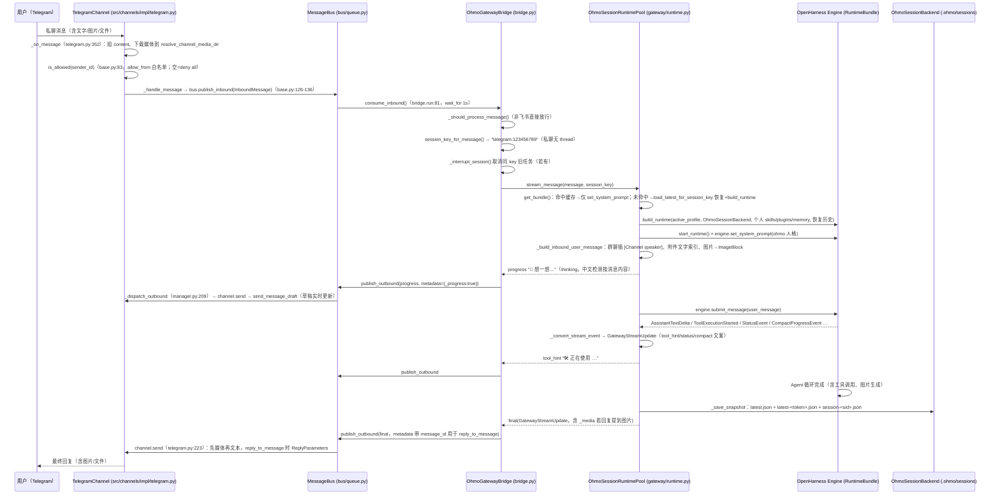

# OpenHarness 源码分析：ohmo 个人代理应用（深度详解版）

> 分析对象：`ohmo/` 下共 19 个 `.py` 文件（约 4450 行），其中 16 个为功能模块（约 4435 行，不含纯结构型的 `__init__.py` 与 `__main__.py`）＋ 必要的 `src/openharness` 复用点。
>
> | 文件 | 行数 | 职责 |
> | --- | --- | --- |
> | `ohmo/__init__.py` | 5 | 包元数据，声明 `__version__ = "0.1.9"` |
> | `ohmo/__main__.py` | 8 | `python -m ohmo` 入口，转发到 `cli.py` 的 `app()` |
> | `ohmo/cli.py` | 710 | Typer CLI 入口，全部子命令与交互配置向导 |
> | `ohmo/workspace.py` | 319 | `~/.ohmo` 路径/模板/初始化/健康检查 |
> | `ohmo/gateway/runtime.py` | 1254 | 渠道驱动的会话运行时池、引擎流转换、群组工具注册 |
> | `ohmo/gateway/service.py` | 450 | Gateway 生命周期（前台/后台/状态心跳/原地重启） |
> | `ohmo/gateway/bridge.py` | 414 | 消息总线 ↔ ohmo 运行时池的桥接与任务抢占 |
> | `ohmo/runtime.py` | 218 | CLI 后端/React TUI/print 三种模式的驱动器 |
> | `ohmo/memory.py` | 219 | 个人记忆（文件级管理 + `/memory` 命令后端） |
> | `ohmo/session_storage.py` | 202 | 多会话快照持久化 + `OhmoSessionBackend` |
> | `ohmo/gateway/__init__.py` | 2 | gateway 子包空导出 |
> | `ohmo/gateway/group_tool.py` | 158 | 飞书建群工具 `ohmo_create_feishu_group`（模型调用） |
> | `ohmo/gateway/provider_commands.py` | 139 | `/provider`、`/model` 网关作用域命令 |
> | `ohmo/group_registry.py` | 95 | 受管群组元数据持久化 |
> | `ohmo/gateway/notify.py` | 78 | 主动推送（飞书 DM） |
> | `ohmo/prompts.py` | 74 | ohmo 人格系统提示词组装 |
> | `ohmo/gateway/config.py` | 41 | `gateway.json` 读写与通道兼容模型映射 |
> | `ohmo/gateway/models.py` | 33 | `GatewayConfig` / `GatewayState`（pydantic） |
> | `ohmo/gateway/router.py` | 31 | 会话键（session_key）路由推导 |

> 行号均与当前源码逐一核对，可直接用编辑器跳转验证；对 `src/openharness` 的引用行号也已在 1.3 节核实。

---

## 目录

1. [ohmo 总体职责与架构](#一ohmo-总体职责与架构)
2. [CLI（ohmo/cli.py）：逐命令走读](#二cli-ohmocli.py逐命令走读)
3. [Workspace（ohmo/workspace.py）：初始化与文件结构](#三workspace-ohmoworkspace.py初始化与文件结构)
4. [Runtime 与 prompts：复用 build_runtime / run_backend_host](#四runtime-与-prompts复用-build_runtime--run_backend_host)
5. [Memory 与 session_storage：个人记忆与会话快照](#五memory-与-session_storage个人记忆与会话快照)
6. [Gateway（ohmo/gateway/）：逐模块逐方法走读](#六gateway-ohmogateway逐模块逐方法走读)
7. [端到端时序：Telegram 消息的完整旅程](#七端到端时序telegram-消息的完整旅程)
8. [关键类 / 函数清单](#八关键类--函数清单)
9. [设计要点小结](#九设计要点小结)

---

## 一、ohmo 总体职责与架构

### 1.1 定位

ohmo 是搭建在 OpenHarness **之上**（而非内部）的一个"个人 AI 代理"应用，本质是一层很薄的应用壳：

- **复用** OpenHarness 的引擎（engine）、UI 运行时（ui/runtime）、消息渠道（channels）、记忆体系（memory）、会话后端（services/session_storage）、命令体系（commands）。
- **新增** 一套面向"个人"的语义：`soul.md / identity.md / user.md` 人格文件、个人记忆区 `memory/`、跨渠道多会话存储 `sessions/`，以及把聊天软件消息（飞书/Slack/Telegram/Discord）驱动起来的异步 Gateway。

入口链：

```
python -m ohmo              → ohmo/__main__.py:7 app()（ohmo/cli.py:38 的 Typer 实例）
ohmo 命令                   → 安装后的命令脚本 → 同一 cli.py
```

`ohmo/__init__.py:5` 声明 `__version__ = "0.1.9"`。

### 1.2 目录职责总览

```
ohmo/
├── __init__.py         版本号 0.1.9（第 5 行）
├── __main__.py         python -m ohmo 入口（第 7 行调 app()）
├── cli.py              全部命令（app / memory / soul / user / gateway 五个 Typer 组）
├── runtime.py          把 openharness.ui.runtime 包装成 ohmo 的三种运行模式
├── prompts.py          组装 ohmo 人格系统提示词（9 段式）
├── workspace.py        ~/.ohmo 的一切路径 + 初始化/种子模板 + 健康检查
├── memory.py           个人记忆：文件管理 + 绑定到 openharness 的 /memory 命令
├── session_storage.py  多会话快照持久化 + OhmoSessionBackend
├── group_registry.py   受管群组元数据（飞书群 ↔ cwd/repo 绑定）
└── gateway/            “聊天软件代理服务”整层
    ├── config.py       gateway.json 读写 + 映射到 Config.channels
    ├── models.py       GatewayConfig / GatewayState（pydantic）
    ├── router.py       由 InboundMessage 推导 session_key
    ├── service.py      进程生命周期：前台运行、拉起的后台进程、状态文件
    ├── bridge.py       消费渠道消息 → 交给 runtime 池 → 把回复发布回总线
    ├── runtime.py      OhmoSessionRuntimePool：每会话一个 RuntimeBundle + 流转换
    ├── provider_commands.py  /provider、/model（网关修改 provider 配置）
    ├── group_tool.py    建飞书群 tool（模型调用）
    └── notify.py        主动推送（飞书 DM）
```

### 1.3 对 `src/openharness` 的关键复用点（已核实行号）

| ohmo 使用处 | 复用的 OpenHarness API | 位置 |
| --- | --- | --- |
| `ohmo/runtime.py:45` | `run_backend_host()` —— 共享 React 后端宿主（http/stdio 协议） | `src/openharness/ui/backend_host.py:883` |
| `ohmo/runtime.py:14`、`ohmo/gateway/runtime.py:34` | `build_runtime / start_runtime / close_runtime / handle_line / _last_user_text` | `src/openharness/ui/runtime.py:274/474/482/621/504` |
| `ohmo/gateway/runtime.py:33` | `build_runtime_system_prompt()` —— 按设置展开运行时提示词 | `src/openharness/prompts/context.py:102` |
| `ohmo/prompts.py:8` | `get_base_system_prompt()` —— 基础系统提示词 | `src/openharness/prompts/system_prompt.py:58` |
| `ohmo/memory.py:8` | `scan_memory_files()` | `src/openharness/memory/scan.py:20` |
| `ohmo/memory.py:8` | `MemoryCommandBackend` —— `/memory` 命令后端基类 | `src/openharness/commands/registry.py:118` |
| `ohmo/gateway/runtime.py:16` | `CommandContext / CommandResult / SlashCommand / lookup_skill_slash_command` | `src/openharness/commands/registry.py:132/103/154/398` |
| `ohmo/session_storage.py:14-18` | `SessionBackend` 协议 + `_persistable_tool_metadata()/_sanitize_snapshot_payload()` | `src/openharness/services/session_backend.py:14`、`services/session_storage.py` |
| `ohmo/gateway/service.py:19-21` | `InboundMessage / OutboundMessage / MessageBus / ChannelManager` | `src/openharness/channels/bus/events.py:9/28`、`bus/queue.py`、`channels/impl/manager.py:27` |
| `ohmo/gateway/config.py:7` | `Config` 之 `channels`（`ChannelConfigs`） | `src/openharness/config/schema.py:102` |
| `ohmo/gateway/service.py:138` | 飞书通道的 `create_managed_group()`（真实建群） | `src/openharness/channels/impl/feishu.py:1036` |
| `ohmo/memory.py:22-23` | `exclusive_file_lock()` / `atomic_write_text()` | `src/openharness/utils/file_lock.py`、`utils/fs.py` |
| `ohmo/gateway/runtime.py:23` | `MaxTurnsExceeded` | `src/openharness/engine/query.py:129` |
| `ohmo/gateway/runtime.py:17-22` | `ConversationMessage / ImageBlock / TextBlock / sanitize_conversation_messages` | `src/openharness/engine/messages.py` |
| `ohmo/gateway/runtime.py:24-32` | `AssistantTextDelta / AssistantTurnComplete / CompactProgressEvent / ErrorEvent / StatusEvent / ToolExecutionStarted / ToolExecutionCompleted` | `src/openharness/engine/stream_events.py` |
| `ohmo/cli.py:12-13` | `AuthManager / load_settings`（provider profile 探测） | `src/openharness/auth/manager.py`、`src/openharness/config/__init__.py` |

**架构一句话**：ohmo 不重复造"Agent 循环"，而是把 OpenHarness 已经做好的 `build_runtime()` 产出物（`RuntimeBundle`，内含 `engine`、`tool_registry`、`commands`、`session_backend`、`hook_executor` 等，见 `ui/runtime.py:121`）当作**每条渠道会话持有一个的"重型对象"**，自己只做会话键路由、消息转换、任务抢占与网关生命周期。

### 1.4 两种运行面

- **本地运行面（CLI）**：`ohmo` 本身 / `ohmo --print`。走 `run_ohmo_backend` / `run_ohmo_print_mode` / `launch_ohmo_react_tui`。
- **网关运行面（daemon）**：`ohmo gateway run`。前台用 asyncio 跑 `MessageBus + ChannelManager + OhmoGatewayBridge + OhmoSessionRuntimePool`，可被 `gateway start` 拉成后台进程（子进程 + pid 文件 + 状态文件）。

两条面共享相同的人格/记忆/会话底座，这正是"在一个 `~/.ohmo` 工作区里、在 IM 里和终端里和同一个 ohmo 协作"的设计。

---

## 二、CLI（ohmo/cli.py）：逐命令走读

### 2.1 Typer 结构（cli.py:38-52）

`cli.py:38-52` 构建五个相互嵌套的 Typer 组：

```python
app = typer.Typer(name="ohmo", help="ohmo: a personal-agent app built on top of OpenHarness.",
                  invoke_without_command=True, add_completion=False)   # 38-43
memory_app = typer.Typer(name="memory", help="Manage .ohmo memory")    # 44
soul_app    = typer.Typer(name="soul",   help="Inspect or edit soul.md")  # 45
user_app    = typer.Typer(name="user",   help="Inspect or edit user.md")  # 46
gateway_app = typer.Typer(name="gateway", help="Run the ohmo gateway")    # 47
app.add_typer(memory_app)  # 49
app.add_typer(soul_app)    # 50
app.add_typer(user_app)    # 51
app.add_typer(gateway_app) # 52
```

常量：`_INTERACTIVE_CHANNELS = ("telegram", "slack", "discord", "feishu")`（54），`_WORKSPACE_HELP`（55）。

### 2.2 交互辅助函数族（cli.py:58-145）

| 函数 | 行号 | 行为 |
| --- | --- | --- |
| `_can_use_questionary()` | 58-68 | 判断"真 TTY + questionary 可用"：`sys.stdin/stdout.isatty()`、非替换的 `sys.__stdin__/__stdout__`、`import questionary` 成功。全真才走美观交互。 |
| `_select_with_questionary(title, options, default_value)` | 71-90 | `questionary.Choice` 列表 + `questionary.select`，取消则 `typer.Abort()`。 |
| `_confirm_prompt(message, default=False)` | 93-102 | questionary.confirm，非 TTY 回退 `typer.confirm`。 |
| `_text_prompt(message, default="")` | 105-114 | questionary.text，非 TTY 回退 `typer.prompt`。 |
| `_select_from_menu(title, options, default_value)` | 117-138 | 优先 questionary；否则编号菜单（打印 `1. label (default)`…），`typer.prompt("Choose", default=默认序号)`，非法输入抛 `typer.BadParameter`。 |
| `_format_provider_profile_label(info)` | 141-145 | 未配置的 profile 追加 `(missing)` 标记。 |

### 2.3 全局回调 `main()` 与顶层选项（cli.py:447-523）

`@app.callback(invoke_without_command=True)`（447）——不带子命令时进入默认行为。

| 参数 | 选项 | 含义 |
| --- | --- | --- |
| `print_mode` | `--print / -p <prompt>` | 单次问答并打印结果（print 模式） |
| `model` | `--model <m>` | 本会话模型覆盖 |
| `profile` | `--profile <p>` | provider profile（claude-api / codex / openai-compatible 等） |
| `workspace` | `--workspace <path>` | 工作区路径（默认 `~/.ohmo`） |
| `max_turns` | `--max-turns <n>` | 覆盖最大轮数 |
| `cwd` | `--cwd <dir>`（默认 `str(Path.cwd())`） | 工作目录 |
| `backend_only` | `--backend-only`（隐藏） | 只跑共享 React 后端宿主（供 TUI 前端进程调用） |
| `resume` | `--resume <id>` | 按会话 id 恢复 |
| `continue_session` | `--continue` | 继续最近一次 ohmo 会话 |

分支逻辑：

```python
if ctx.invoked_subcommand is not None: return            # 461-462 有子命令就交给子命令
cwd_path = str(Path(cwd).resolve())                       # 464
workspace_root = initialize_workspace(workspace)          # 465 确保工作区存在并种模板
backend = OhmoSessionBackend(workspace_root)              # 466 共享会话后端
# --continue → backend.load_latest(cwd_path)（469-475）；--resume → backend.load_by_id(cwd_path, resume)（476-482）
#   两者都取快照的 messages / tool_metadata 作为 restore_* 参数
# --backend-only → asyncio.run(run_ohmo_backend(...))（484-497）
# --print         → asyncio.run(run_ohmo_print_mode(...))（499-511）
# 兜底            → asyncio.run(launch_ohmo_react_tui(...))（513-523）
```

**恢复机制关键**：`load_latest()` / `load_by_id()` 读出的快照包含 `messages` 与 `tool_metadata`，分别作为 `run_ohmo_backend` 的 `restore_messages` / `restore_tool_metadata` 传入（493-494），引擎据此恢复会话——实现"跨终端会话续聊"。

### 2.4 根命令逐一走读

#### A. `ohmo init`（cli.py:526-552）

参数：`--cwd`（默认 `Path.cwd()`，保留给未来项目覆盖）、`--workspace`、`--interactive/--no-interactive`（默认 True）。

流程：
1. `get_workspace_root(workspace)`（537）解析根路径，记 `already_exists = root_path.exists()`（538）。
2. `initialize_workspace(root_path)`（539）——见第三章，建目录 + 种模板。
3. 打印 `Initialized ohmo workspace at {root}`（540）。
4. 若已存在：
   - 非交互 → 提示 `Use ohmo config` 并返回（543-545）；
   - 交互 → `_confirm_prompt("Open configuration now?", default=True)`（546），拒绝则提示后返回（547-548）。
5. 若 `interactive` → `_run_gateway_config_wizard(root)`（550）→ `_print_gateway_config_summary(config)`（551）→ 打印配置保存路径（552）。

**写文件**：`initialize_workspace` 负责的 `soul.md/user.md/identity.md/memory/MEMORY.md/BOOTSTRAP.md/state.json/gateway.json`（见 3.2）；向导再覆写 `gateway.json`。

#### B. `ohmo config`（cli.py:555-566）

参数：`--cwd`、`--workspace`。

流程：
1. `cwd_path = str(Path(cwd).resolve())`（561）、`initialize_workspace(workspace)`（562）。
2. `_run_gateway_config_wizard(workspace_root)`（563）→ `_print_gateway_config_summary`（564）→ 打印保存路径（565）。
3. `_maybe_restart_gateway(cwd=cwd_path, workspace=workspace_root)`（566）：若 Gateway 正在跑，询问并 `stop_gateway_process` + `start_gateway_process`（见 2.7）。

#### C. `ohmo doctor`（cli.py:569-592）

参数：`--cwd`、`--workspace`。

流程：
1. `initialize_workspace`（576）——doctor 也会顺带补全缺失模板。
2. `workspace_health(workspace_root)`（577）——11 项存在性检查（见 3.5）。
3. `AuthManager(load_settings()).get_profile_statuses()`（578-579）列出 provider 状态。
4. 逐行打印：每项健康项 `ok/missing`、`project_cwd`、`workspace_root`、`workspace_state`、`gateway_config`、`available_profiles`（每条 `name: label (configured/missing auth)`）。

### 2.5 `ohmo memory` 组

| 命令 | 定义 | 参数 | 行为 |
| --- | --- | --- | --- |
| `ohmo memory list` | 595-598 | `--workspace` | 遍历 `list_memory_files(workspace)`（memory.py:28），逐行打印文件名 |
| `ohmo memory add <title> <content>` | 601-608 | 两个位置参数 + `--workspace` | `add_memory_entry(workspace, title, content)`（memory.py:41），打印 `Added memory entry {path.name}` |
| `ohmo memory remove <name>` | 611-620 | 位置参数 + `--workspace` | `remove_memory_entry(workspace, name)`（memory.py:110），成功打印 `Removed...`，未找到则 stderr 打印并 `typer.Exit(1)` |

### 2.6 `ohmo soul` / `ohmo user` 组（共用 `_show_or_edit`，cli.py:623-632）

`_show_or_edit(path, set_text)`：
1. `path.parent.mkdir(parents=True, exist_ok=True)`（624）。
2. `set_text` 非空 → `path.write_text(set_text.strip() + "\n")`，打印 `Updated {path}`（625-628）。
3. 否则文件不存在 → stderr + `typer.Exit(1)`（629-631）；存在 → `print(path.read_text())`（632）。

| 命令 | 定义 | 参数 | 效果 |
| --- | --- | --- | --- |
| `ohmo soul show` | 635-637 | `--workspace` | 打印 `soul.md` |
| `ohmo soul edit [--set TEXT]` | 640-645 | `--workspace`、`--set` | 有 `--set` 则覆盖写入，否则打印现有内容（即"编辑"是靠 `--set`） |
| `ohmo user show` | 648-650 | `--workspace` | 打印 `user.md` |
| `ohmo user edit [--set TEXT]` | 653-658 | `--workspace`、`--set` | 同上 |

### 2.7 `ohmo gateway` 组

| 命令 | 定义 | 参数 | 行为 |
| --- | --- | --- | --- |
| `ohmo gateway run` | 661-671 | `--cwd`、`--workspace`、隐藏 `--console-log/--no-console-log`、`--log-file/--no-log-file` | `_configure_gateway_logging(...)`（669）→ `OhmoGatewayService(cwd, workspace).run_foreground()`（670-671，包在 `asyncio.run`） |
| `ohmo gateway start` | 674-680 | `--cwd`、`--workspace` | `start_gateway_process(cwd, workspace)`（service.py:256）返回 pid |
| `ohmo gateway stop` | 683-691 | `--cwd`、`--workspace` | `stop_gateway_process`（service.py:382），返回布尔决定打印"stopped"或"not running" |
| `ohmo gateway restart` | 694-701 | `--cwd`、`--workspace` | `stop_gateway_process` + `start_gateway_process` |
| `ohmo gateway status` | 704-710 | `--cwd`、`--workspace` | `gateway_status`（service.py:416）→ `state.model_dump_json(indent=2)` 打印 JSON |

### 2.8 配置向导与辅助（核心交互逻辑）

#### `_prompt_provider_profile`（cli.py:148-192）

1. `load_settings()` + `AuthManager(settings).get_profile_statuses()`（149-150）拿到全部 profile 及其 `configured/label/base_url/model`。
2. `default_value = load_gateway_config(workspace).provider_profile`（151）——默认值来自现有配置。
3. `hints` 表（152-155）：`claude-api` → "Claude / Kimi / GLM / MiniMax"（配色 `fg:#7aa2f7`），`openai-compatible` → "OpenAI / OpenRouter"（`fg:#9ece6a`）。
4. questionary 分支（157-179）：每个 profile 组装带配色/hint/`(missing)` 的 `questionary.Choice`，`checked=(name == default_value)`。
5. 回退分支（181-192）：`_format_provider_profile_label` 组装纯文本菜单，`_select_from_menu`。

#### `_prompt_channels`（cli.py:195-325）——四渠道交互配置

对 `_INTERACTIVE_CHANNELS` 逐个处理：
- 已在 `enabled_channels`：询问"Reconfigure?"（204），否 → 沿用 `prior` 配置（205-206）。
- 未启用：询问"Enable?"（207），否 → 跳过（208）。
- 启用后按渠道细分：

| 渠道 | 提示的字段（默认取自 `prior`） |
| --- | --- |
| 全部 | `allow_from`：逗号分隔的 id 白名单；留空即 deny all；`*` 放行所有人（211-215） |
| telegram | `token`（218）、`reply_to_message`（222，默认 True） |
| slack | `bot_token`（227）、`app_token`（231）、`mode` 固定 `"socket"`（235）、`reply_in_thread`（236）、`group_policy`：`mention/open/allowlist`（240-248，默认 mention） |
| discord | `token`（250）、`gateway_url`（默认 `wss://gateway.discord.gg/?v=10&encoding=json`，254）、`intents`（默认 513，258）、`group_policy`：`mention/open`（264-271，默认 mention） |
| feishu | `domain`（`https://open.feishu.cn` / `https://open.larksuite.com`，273-280）、`app_id`（281）、`app_secret`（285）、`encrypt_key`（289）、`verification_token`（293）、`react_emoji`（默认 `OK`，297）、`group_policy`：`managed_or_mention/mention/open`（301-309，默认 managed_or_mention）、`bot_names`（默认 `["ohmo","openclaw","openharness"]`，310-319）、`bot_open_id`（320-323） |

返回 `(enabled: list[str], configs: dict[str, dict])`（325）。

#### `_run_gateway_config_wizard`（cli.py:328-369）

1. `existing = load_gateway_config(workspace)`（330）。
2. `_prompt_provider_profile`（331）→ `_prompt_channels`（332）。
3. `send_progress`（333-336）、`send_tool_hints`（337-340）两个确认。
4. `allow_remote_admin_commands`（341-344）：为 True 时再问 `allowed_remote_admin_commands` 逗号分隔列表（348-356），条目 `lstrip("/")` 存库。
5. `existing.model_copy(update={...})`（357-367）保留未问及的字段（如 `permission_mode/sandbox_enabled/session_routing/log_level`）。
6. `save_gateway_config(config, workspace)`（368）→ 返回（369）。

#### `_print_gateway_config_summary`（cli.py:372-396）

- 有启用渠道 → 打印渠道名 + `provider_profile`，并列出"allow_from 为空 = 远程访问被拒"的渠道（379-387）。
- 无渠道 → 打印 `provider_profile; no channels enabled yet`。
- `allow_remote_admin_commands` 且列表非空 → 打印 `/name` 白名单；否则提示 `Remote admin commands remain local-only.`。

#### `_maybe_restart_gateway`（cli.py:399-408）

`gateway_status(cwd, workspace)`（400）→ 若 `state.running` 则确认重启（403）→ `stop_gateway_process` + `start_gateway_process`（406-407）。

#### 日志配置（cli.py:411-444）

- `_configure_gateway_logging(workspace, console=True, log_file=True)`：读 `gateway.json` 的 `log_level`（默认 INFO）→ `_build_gateway_logging_handlers` → `logging.basicConfig(force=True)`。
- `_build_gateway_logging_handlers`：console 用 `StreamHandler`；文件用 `logs/gateway.log` 的 `FileHandler(delay=True)`（自动 mkdir 父目录）。

---

## 三、Workspace（ohmo/workspace.py）：初始化与文件结构

### 3.1 工作区根解析（workspace.py:163-175）

```python
def get_workspace_root(workspace=None):
    # 1. 显式 workspace 参数 → 2. 环境变量 OHMO_WORKSPACE → 3. ~/.ohmo
    explicit = workspace or os.environ.get("OHMO_WORKSPACE")      # 171
    if explicit:
        path = Path(explicit).expanduser().resolve()              # 173
        return path if path.name == WORKSPACE_DIRNAME else path   # 174 不强制重命名为 .ohmo
    return (Path.home() / WORKSPACE_DIRNAME).resolve()            # 175
```

`WORKSPACE_DIRNAME = ".ohmo"`（9）。

### 3.2 `initialize_workspace`（workspace.py:252-301）——每次调用都会补齐

先 `ensure_workspace()`（238-249）建 **8 个目录**：

| 目录 | 函数 | 行号 |
| --- | --- | --- |
| 根 `~/.ohmo/` | root.mkdir | 241 |
| `memory/` | get_memory_dir | 242 |
| `skills/` | get_skills_dir | 243 |
| `plugins/` | get_plugins_dir | 244 |
| `groups/` | get_groups_dir | 245 |
| `sessions/` | get_sessions_dir | 246 |
| `logs/` | get_logs_dir | 247 |
| `attachments/` | get_attachments_dir | 248 |

然后按"缺失即写"种模板（255-263）——模板常量在 3.4：

```
~/.ohmo/
├── soul.md                 ← SOUL_TEMPLATE（workspace.py:11-58）    “你是谁”
├── user.md                 ← USER_TEMPLATE（60-105）                “你的用户”
├── identity.md             ← IDENTITY_TEMPLATE（107-116）           “你的形态”
├── memory/
│   └── MEMORY.md           ← MEMORY_INDEX_TEMPLATE（156-160）       “记忆索引”
├── BOOTSTRAP.md            ← BOOTSTRAP_TEMPLATE（118-154），只在 bootstrap_seeded=False 时写一次
├── state.json              ← 运行时状态（含 bootstrap_seeded 标志）
└── gateway.json            ← 种子配置（281-300）
```

**state.json 逻辑（264-278）**：
1. 不存在 → 写 `{"app": "ohmo", "workspace": "<root>"}`。
2. 存在 → `json.loads` 读取（读坏则回退默认，270-272）。
3. `bootstrap_seeded` 为假 → 置 True、写 `BOOTSTRAP.md`、落盘（274-278）。**因此 BOOTSTRAP.md 只在首次真正初始化时生成一次**。

**gateway.json 种子（279-300）**——只在不存在时写：

```json
{
  "provider_profile": "codex",
  "enabled_channels": [],
  "session_routing": "chat-thread",
  "send_progress": true,
  "send_tool_hints": true,
  "permission_mode": "default",
  "sandbox_enabled": false,
  "allow_remote_admin_commands": false,
  "allowed_remote_admin_commands": [],
  "log_level": "INFO",
  "channel_configs": {}
}
```

### 3.3 模板内容来源（种子文案）

| 模板 | 行号 | 要点 |
| --- | --- | --- |
| `SOUL_TEMPLATE` | 11-58 | Core truths（真诚有用、有判断力、先自己查再提问、用能力赢得信任、把访问权当亲密）；Boundaries（隐私、外向动作前先问、群里不要假装用户）；Vibe；Continuity（指向 user.md/memory/state.json，明确要求"如果你实质改了这个文件要告诉用户"） |
| `USER_TEMPLATE` | 60-105 | Profile（Name/称呼/代词/时区/语言）、Defaults（语气/回答长度/决策风格/工作时长）、Ongoing context（项目/职责/压力/工具）、Preferences、Relationship notes、Notes（"学得足够帮助，不建档案"） |
| `IDENTITY_TEMPLATE` | 107-116 | 名字 ohmo、kind personal agent、vibe、Signature（留空待填） |
| `BOOTSTRAP_TEMPLATE` | 118-154 | 首次对话目标：弄清用户怎么称呼你/要什么关系；学用户时区/项目/常要的帮助；把工作区做起来（更新 IDENTITY.md/user.md/memory/）；风格上"不要倒问卷，先像人一样开口"；完成后可删本文件 |
| `MEMORY_INDEX_TEMPLATE` | 156-160 | 说明"聚焦个人事实写 markdown、保持简短、随记忆增长更新索引" |

### 3.4 路径函数全集（workspace.py:178-235）

| 函数 | 行号 | 返回 |
| --- | --- | --- |
| `get_soul_path` | 178 | `root/soul.md` |
| `get_user_path` | 182 | `root/user.md` |
| `get_identity_path` | 186 | `root/identity.md` |
| `get_bootstrap_path` | 190 | `root/BOOTSTRAP.md` |
| `get_memory_dir` | 194 | `root/memory` |
| `get_skills_dir` | 198 | `root/skills` |
| `get_plugins_dir` | 202 | `root/plugins` |
| `get_groups_dir` | 206 | `root/groups` |
| `get_memory_index_path` | 210 | `root/memory/MEMORY.md` |
| `get_sessions_dir` | 214 | `root/sessions` |
| `get_logs_dir` | 218 | `root/logs` |
| `get_attachments_dir` | 222 | `root/attachments` |
| `get_state_path` | 226 | `root/state.json` |
| `get_gateway_config_path` | 230 | `root/gateway.json` |
| `get_gateway_restart_notice_path` | 234 | `root/gateway-restart-notice.json` |

### 3.5 健康检查（workspace.py:304-319）

`workspace_health()` 返回 11 项布尔：`workspace / soul / user / identity / memory_dir / skills_dir / plugins_dir / groups_dir / memory_index / sessions_dir / gateway_config`。

---

## 四、Runtime 与 prompts：复用 build_runtime / run_backend_host

### 4.1 prompts.py：人格注入（9 段式）

`_read_text(path)`（prompts.py:20-24）：不存在或空 → `None`；读取用 `errors="replace"` 容忍编码错误。

`build_ohmo_system_prompt(cwd, *, workspace, extra_prompt, include_project_memory)`（prompts.py:27-74）逐段叠加，最终 `"\n\n".join(非空段)`（74）：

| 段序 | 标题 | 内容来源 | 行号 |
| --- | --- | --- | --- |
| 1 | （无标题） | `get_base_system_prompt()` —— OpenHarness 基础提示词 | 36 |
| 2 | `# Additional Instructions` | `extra_prompt`（可选） | 38-39 |
| 3 | `# ohmo Soul` | `soul.md` | 41-43 |
| 4 | `# ohmo Identity` | `identity.md` | 45-47 |
| 5 | `# User Profile` | `user.md` | 49-51 |
| 6 | `# First-Run Bootstrap` | `BOOTSTRAP.md` | 53-55 |
| 7 | `# ohmo Workspace` | 固定文案：个人工作区根目录、个人记忆与会话位于共享工作区、**只在 ohmo 会话内可 resume，不要假设与普通 OpenHarness 会话互通** | 57-64 |
| 8 | `# ohmo Memory` | `load_ohmo_memory_prompt(root)` ← 个人记忆区（memory.py:156） | 66-67 |
| 9 | （项目记忆段） | 仅当 `include_project_memory=True`：`openharness.memory.load_memory_prompt(cwd)` | 69-72 |

> 设计要点：人格是**外置文件**而非硬编码字符串 —— 用户在 `soul.md`/`identity.md`/`user.md` 里的话会被当作系统提示词持续注入，呼应 BOOTSTRAP 的"第一印象更新人格文件"循环。

### 4.2 runtime.py：三种运行模式 + 命令构造

#### `_ohmo_extra_roots`（runtime.py:23-25）

`initialize_workspace(workspace)` 确保工作区，返回 `((skills,), (plugins,))` 二元组 —— 两个路径分别注入引擎的 `extra_skill_dirs` 与 `extra_plugin_roots`。

#### `run_ohmo_backend`（runtime.py:28-66）—— `--backend-only`

```python
del backend_only
cwd_path = str(Path(cwd or Path.cwd()).resolve())          # 42
workspace_root = initialize_workspace(workspace)           # 43
extra_skill_dirs, extra_plugin_roots = _ohmo_extra_roots(workspace_root)  # 44
return await run_backend_host(                             # 45 → ui/backend_host.py:883
    cwd=cwd_path,
    model=model, max_turns=max_turns,
    system_prompt=build_ohmo_system_prompt(cwd_path, workspace=workspace_root),  # 49
    active_profile=provider_profile,
    api_client=api_client,
    restore_messages=..., restore_tool_metadata=...,
    enforce_max_turns=max_turns is not None,               # 54 只有显式 --max-turns 才强制轮数上限
    session_backend=OhmoSessionBackend(workspace_root),    # 55 会话钉到 ~/.ohmo/sessions
    extra_skill_dirs=extra_skill_dirs,
    extra_plugin_roots=extra_plugin_roots,
    memory_backend=create_memory_command_backend(workspace_root),   # 58 个人 /memory
    include_project_memory=False,                          # 59 个人语义下关闭项目记忆
    autodream_context={"memory_dir": ..., "session_dir": ...,
                       "app_label": "ohmo personal memory", "runner_module": "ohmo"},  # 60-65
)
```

`run_backend_host`（backend_host.py:883-931）构造 `ReactBackendHost(BackendHostConfig(...))` 并 `host.run()`，通过 http/stdio 与 React TUI 前端通信。

#### `build_ohmo_backend_command`（runtime.py:69-89）

生成 TUI 前端要执行的命令串：`[sys.executable, "-m", "ohmo", "--backend-only"]` + 依次追加 `--cwd/--workspace/--model/--max-turns/--profile`（有值才追加）。

#### `launch_ohmo_react_tui`（runtime.py:92-144）

1. `get_frontend_dir()`（101）定位 React 前端目录；`package.json` 缺失则抛错（103-104）。
2. `_resolve_npm()`（106）；`node_modules` 不存在则先 `npm install --no-fund --no-audit`（107-116）。
3. 构造 `env["OPENHARNESS_FRONTEND_CONFIG"] = json.dumps({backend_command, initial_prompt: None, theme: "default"})`（120-133）。
4. `_resolve_tsx(frontend_dir)`（134）→ `create_subprocess_exec(*tsx_cmd, "src/index.tsx", cwd=frontend_dir, env=env)`（135-143）→ `await process.wait()`（144）。

#### `run_ohmo_print_mode`（runtime.py:147-218）—— `--print`

1. 解析 cwd/workspace、`_ohmo_extra_roots`（157-159）。
2. `os.chdir(cwd_path)`（161），`finally: os.chdir(previous_cwd)` 恢复（218）。
3. `build_runtime(...)`（163-180）——**与 `run_ohmo_backend` 的 ohmo 参数完全同构**（见 4.3 的公共参数块）。
4. `start_runtime(bundle)`（181）→ 定义渲染回调（183-206）：`AssistantTextDelta` 流式写 stdout、`AssistantTurnComplete` 写换行、`ErrorEvent` 置 `saw_error` 并写 stderr、`CompactProgressEvent`/`StatusEvent` 写 stderr。
5. `handle_line(bundle, prompt, print_system, render_event, clear_output)`（208-214）→ `close_runtime(bundle)`（215）→ 返回 `1 if saw_error else 0`（216）。

### 4.3 三种模式的公共参数块（`runtime.py:45-66` 与 `163-179` 几乎相同）

```python
system_prompt=build_ohmo_system_prompt(cwd_path, workspace=workspace_root),
session_backend=OhmoSessionBackend(workspace_root),
extra_skill_dirs=extra_skill_dirs,
extra_plugin_roots=extra_plugin_roots,
memory_backend=create_memory_command_backend(workspace_root),
include_project_memory=False,
autodream_context={"memory_dir": ..., "session_dir": ..., "app_label": "ohmo personal memory", "runner_module": "ohmo"},
```

### 4.4 会话内 Agent 循环本身

每次用户消息进入，引擎在 `handle_line()`（print 模式）或 `run_backend_host`（backend-only）内部跑 OpenHarness 的 Agent 主循环（`engine/query.py:633 run_query()`），ohmo 只负责装载、喂入和回收。turns 控制：`enforce_max_turns=max_turns is not None`，即只有显式 `--max-turns` 时才强制轮数上限。

---

## 五、Memory 与 session_storage：个人记忆与会话快照

### 5.1 memory.py：文件级个人记忆（219 行）

核心是 **按文件管理 + 复用 OpenHarness 内存 schema**（`memory/scan.py`、`memory/schema.py`、`utils/file_lock.py`、`utils/fs.py`）。

#### `list_memory_files`（memory.py:28-38）

`scan_memory_files(_scan_cwd(...), max_files=None, memory_dir=memory_dir)` 枚举 `memory/*.md`，按 `header.path` 排序返回。

#### `add_memory_entry(workspace, title, content)`（memory.py:41-107）——新增/更新记忆

1. `slug = 小写标题的[^a-zA-Z0-9]+ → _`（45），空则 `"memory"`。
2. `with exclusive_file_lock(memory_dir / ".memory.lock")`（46）——写锁。
3. `memory_type="personal"`、`category="preference"`（47-48）、`body = content.strip() + "\n"`。
4. `signature = compute_memory_signature(body, memory_type, category)`（50）。
5. 全量扫描（含 disabled/expired，51-57），找 `_effective_signature == signature` 的**重复条目**（58-61）——命中则复用原文件路径，否则 `_next_memory_path` 生成 `slug.md` 或 `slug_2.md`…（62）。
6. 区分两种情况：
   - 文件已存在（65-77）：`split_memory_file` 拆元数据/正文，`memory_metadata_from_path` 保留旧 `source/created_at/id`；
   - 新文件（78-81）：`metadata = {}`，`memory_id = generate_memory_id(now)`。
7. 统一 merge 元数据（82-99）：

   ```python
   schema_version=SCHEMA_VERSION, id=memory_id, name=title.strip(),
   description=first_content_line(body) or title.strip(),
   type="personal", category="preference",
   importance=max(coerce_int(...), 1),       # 至少 1
   source="manual", signature=signature,
   created_at=..., updated_at=now_text,
   ttl_days=..., disabled=False, supersedes=...,
   ```

8. `atomic_write_text(path, render_memory_file(metadata, body))`（100）落盘。
9. 索引追加（102-106）：若 `path.name` 不在 `MEMORY.md`，则在末尾追加 `- [title](path.name)` 行。

#### `remove_memory_entry(workspace, name)`（memory.py:110-153）——软删除

1. 扫描（含 disabled/expired），按 `name ∈ {stem, name, title, id}` 匹配（113-123）。
2. 已 disabled 视为不存在（127-128）。
3. 锁内：`split_memory_file` → `metadata["disabled"] = True`、`updated_at` 更新 → `render_memory_file` 写回（130-143）。**文件本身保留**，只置 disabled。
4. 从索引移除包含 `path.name` 的行（145-152）。

#### `load_memory_prompt(workspace, max_files=5)`（memory.py:156-176）

产出 `# ohmo Memory` 段：
- 头部三行说明（161-164）；
- `MEMORY.md` 索引**前 200 行**包进 ```md 代码块（166-168）；
- 前 `max_files` 个记忆文件正文，**每篇截 4000 字符**（170-174）。

#### `create_memory_command_backend(workspace)`（memory.py:179-191）

返回 `MemoryCommandBackend(label="ohmo personal memory", default_type="personal", default_category="preference", get_memory_dir=..., get_entrypoint=..., list_files=..., add_entry=..., remove_entry=...)` —— 引擎内 `/memory` 斜杠命令直接读写 ohmo 个人记忆。

#### 辅助（memory.py:194-219）

- `_scan_cwd(workspace, memory_dir)`（194-195）：显式 workspace 则用它，否则 `memory_dir.parent`。
- `_next_memory_path(memory_dir, slug)`（198-207）：`slug.md` → `slug_2.md` → …。
- `_effective_signature(path, existing_signature)`（210-219）：旧文件无 signature 时按当前正文重新计算。

### 5.2 session_storage.py：多会话快照（202 行）

#### 路径与 token

- `get_session_dir(workspace)`（24-28）：`sessions/`，自动 mkdir。
- `_session_key_token(session_key)`（31-32）：`sha1(session_key)[:12]`。
- `_session_key_latest_path(workspace, session_key)`（35-38）：`sessions/latest-<token>.json`。

#### `save_session_snapshot`（session_storage.py:41-85）——一次写三个文件

1. `sid = session_id or uuid4().hex[:12]`（55）。
2. `messages = sanitize_conversation_messages(messages)`（57）。
3. `summary` = 第一条非空 user 消息文本**前 80 字符**（58-62）。
4. payload 字段（64-77）：

   ```python
   {
     "app": "ohmo",
     "session_id": sid,
     "session_key": session_key,          # 渠道会话才有
     "cwd": str(Path(cwd).resolve()),
     "model": model,
     "system_prompt": system_prompt,
     "messages": [m.model_dump(mode="json") for m in messages],
     "usage": usage.model_dump(),
     "tool_metadata": _persistable_tool_metadata(tool_metadata),   # 复用 openharness 清洗
     "created_at": now,                   # time.time()
     "summary": summary,
     "message_count": len(messages),
   }
   ```

5. 三处落盘（78-84）：
   - `sessions/latest.json`（79-80）；
   - 有 `session_key` 时 `latest-<token>.json`（81-82）；
   - `sessions/session-<sid>.json`（83-84）。

返回 `latest_path`（85）。

#### 读取

| 函数 | 行号 | 语义 |
| --- | --- | --- |
| `load_latest(workspace)` | 88-92 | 读 `latest.json`，经 `_sanitize_snapshot_payload` 清洗 |
| `load_latest_for_session_key(workspace, session_key)` | 95-99 | 读 `latest-<token>.json` —— **渠道会话恢复专用** |
| `list_snapshots(workspace, limit=20)` | 102-121 | 按 mtime 降序列 `session-*.json` 摘要（session_id/summary/message_count/model/created_at） |
| `load_by_id(workspace, session_id)` | 124-131 | `session-<id>.json`；兜底 `latest` 的 session_id 相等或 `"latest"` |
| `export_session_markdown(cwd, workspace, messages)` | 134-148 | 写 `transcript.md` |

#### `OhmoSessionBackend(SessionBackend)`（session_storage.py:151-202，协议在 `services/session_backend.py:14`）

把所有 **cwd 无关** 的接口钉在 ohmo 工作区上：

| 方法 | 行号 | 行为 |
| --- | --- | --- |
| `get_session_dir(cwd)` | 157-158 | 一律返回 `get_session_dir(self._workspace)` —— 任何项目目录的会话都存到同一个个人会话库 |
| `save_snapshot(...)` | 160-182 | 转发 `save_session_snapshot` |
| `load_latest(cwd)` | 184-185 | 转发 `load_latest(workspace)` |
| `list_snapshots(cwd, limit)` | 187-188 | 转发 |
| `load_by_id(cwd, session_id)` | 190-191 | 转发 |
| `load_latest_for_session_key(session_key)` | 193-194 | 转发 —— 这是**协议扩展**（`SessionBackend` 协议本无此方法，`load_latest_for_session_key` 用于渠道恢复） |
| `export_markdown(...)` | 196-202 | 转发 |

### 5.3 会话键的两套体系

- **CLI 端**：`session_id`（User）或 `"latest"`（`--continue`）；
- **Gateway 端**：`session_key`（由 `router.session_key_for_message()` 计算，见 6.4），快照额外存到 `latest-<token>.json`，下次同渠道同会话消息到来即可精确恢复（`get_bundle` 里 `load_latest_for_session_key`，gateway/runtime.py:182）。

---

## 六、Gateway（ohmo/gateway/）：逐模块逐方法走读

### 6.1 架构总览

```
                    ┌──────────────────────────────────────────────────────┐
                    │                    gateway 进程                      │
  飞书/Slack/       │                                                      │
  Telegram/Discord  │   ChannelManager (src/channels/impl/manager.py:27)   │
       │            │      │  start_all()（171）拉起各通道订阅              │
       ▼            │      ▼                                                │
    渠道 WebSocket/  │   MessageBus (src/channels/bus/queue.py)             │
    长轮询/事件       │      │  consume_inbound()(24) / publish_outbound()(28) │
                    │      ▼                                                │
                    │   OhmoGatewayBridge (bridge.py:56)   ← 唯一事件消费者  │
                    │      │  run() 循环：路由 session_key、按需中断旧任务   │
                    │      ▼                                                │
                    │   OhmoSessionRuntimePool (runtime.py:97)              │
                    │      │  每 session_key 一个 RuntimeBundle(engine…)    │
                    │      │  stream_message() → GatewayStreamUpdate 流     │
                    │      ▼                                                │
                    │   bridge._process_message：把 progress/tool_hint/     │
                    │   media/final 转成 OutboundMessage 重新发布回总线      │
                    └──────────────────────────────────────────────────────┘
```

模块分工：

| 模块 | 职责 | 关键对象 / 行号 |
| --- | --- | --- |
| `config.py` | `gateway.json` 读写 + 映射到 OpenHarness 通道兼容模型 | `load/save_gateway_config`（13/21）、`build_channel_manager_config`（29） |
| `models.py` | 配置/状态模型 | `GatewayConfig`（8）、`GatewayState`（24） |
| `router.py` | 由 `InboundMessage` 算 `session_key` | `session_key_for_message`（8） |
| `service.py` | 进程生命周期 | `OhmoGatewayService`（39）、`run_foreground`（198）、进程启停（256/382/416） |
| `bridge.py` | 总线消费者 + 回复发布者 | `OhmoGatewayBridge`（56） |
| `runtime.py` | 会话运行时池 + 事件→渠道文案转换 | `OhmoSessionRuntimePool`（97） |
| `provider_commands.py` | `/provider` `/model` | `handle_gateway_provider_command`（13）、`handle_gateway_model_command`（55） |
| `group_tool.py` | 模型可调的建群工具 | `OhmoCreateFeishuGroupTool`（38） |
| `notify.py` | 主动推送 | `send_feishu_dm`（75）、`_chunk_text`（20） |

### 6.2 models.py：数据结构全部字段（33 行）

#### `GatewayConfig(BaseModel)`（models.py:8-21）

| 字段 | 默认值 | 含义 |
| --- | --- | --- |
| `provider_profile` | `"codex"` | 活动 provider profile 名 |
| `enabled_channels` | `[]` | 启用的渠道名列表 |
| `session_routing` | `"chat-thread"` | 会话路由策略字符串 |
| `send_progress` | `True` | 是否向渠道发进度消息 |
| `send_tool_hints` | `True` | 是否发工具提示 |
| `permission_mode` | `"default"` | 权限模式 |
| `sandbox_enabled` | `False` | 沙箱开关 |
| `allow_remote_admin_commands` | `False` | 是否允许远程管理命令 |
| `allowed_remote_admin_commands` | `[]` | 远程管理命令白名单（不带 `/`） |
| `log_level` | `"INFO"` | 日志级别 |
| `channel_configs` | `{}` | 各渠道自定义配置 `dict[str, dict]` |

#### `GatewayState(BaseModel)`（models.py:24-32）

| 字段 | 默认值 | 含义 |
| --- | --- | --- |
| `running` | `False` | 是否在跑 |
| `pid` | `None` | 进程 id |
| `active_sessions` | `0` | 当前活跃会话数（= 池内 bundle 数） |
| `provider_profile` | `"codex"` | provider profile |
| `enabled_channels` | `[]` | 启用渠道 |
| `last_error` | `None` | 最近错误（渠道 `last_error`） |

### 6.3 config.py：gateway 配置（41 行）

- `load_gateway_config(workspace)`（13-18）：读 `gateway.json` → `GatewayConfig.model_validate_json`；不存在返回默认 `GatewayConfig()`。
- `save_gateway_config(config, workspace)`（21-26）：`model_dump_json(indent=2)` 写入（自动 mkdir）。
- `build_channel_manager_config(config)`（29-41）：投影到 `Config.channels`——
  1. `root.channels.send_progress/send_tool_hints = config.send_progress/send_tool_hints`（32-33）；
  2. 对每个 `enabled_channels` 名字，若 `hasattr(root.channels, name)`，则 `getattr(...).model_copy(update={"enabled": True, **channel_configs[name]})` 并 setattr（34-40）。

### 6.4 router.py：消息路由与会话键（31 行）

`session_key_for_message(message)`（router.py:8-31）：

```python
if message.session_key_override: return message.session_key_override     # 15-16 覆盖键（/group 重建时用）
sender_id = str(message.sender_id).strip() or "anonymous"                 # 17
chat_type = str(message.metadata.get("chat_type") or "").strip().lower()  # 18
is_shared_chat = chat_type in {"group", "chat", "supergroup", "channel", "room"}  # 19
thread_id = message.metadata.get("thread_id") or ...("thread_ts") or ...("message_thread_id")  # 20-24
if thread_id:                                                             # 25-28
    return f"{channel}:{chat_id}:{thread_id}:{sender_id}" if is_shared_chat else f"{channel}:{chat_id}:{thread_id}"
if is_shared_chat:                                                        # 29-30
    return f"{channel}:{chat_id}:{sender_id}"
return f"{channel}:{chat_id}"                                             # 31 私聊
```

**路由语义**：私聊保留 `channel:chat_id` 让长会话可恢复；共享群/线程必须掺入 `sender_id`，避免多人共享同一份 agent 记忆。线程优先于平面群。

### 6.5 bridge.py：消息总线 ↔ ohmo 运行时池（414 行）

#### 顶层函数

- `_content_snippet(text, limit=160)`（21-26）：单行压缩日志预览。
- `_format_gateway_error(exc)`（29-53）：把引擎异常转成用户可读渠道文案——
  - 含 `claude oauth refresh failed` → 提示重跑 `oh auth claude-login` 或切换 profile；
  - 含 `claude oauth refresh token is invalid or expired` → 提示 `claude auth login` 后 `oh auth claude-login`；
  - 含 `auth source not found`/`access token` → `oh setup`/`ohmo config`；
  - 含 `api key`/`auth`/`credential` → 检查 `oh auth status`；
  - 兜底 `[ohmo gateway error] {message}`。

#### `OhmoGatewayBridge`（bridge.py:56-364）

**构造**（59-75）：`bus`、`runtime_pool`、`restart_gateway` 回调、`workspace`、`feishu_group_policy`（经 `_normalize_feishu_group_policy`）。状态：`_running`、`_session_tasks: dict[str, asyncio.Task]`、`_session_cancel_reasons: dict[str, str]`。

**`run()` 主循环（77-135）——渠道事件循环**：

1. `message = await asyncio.wait_for(bus.consume_inbound(), timeout=1.0)`（81）；`TimeoutError` → continue（82-83）；`CancelledError` → break（84-85）。
2. `_should_process_message(message)` 群策略过滤（87-96），不通过则 log 后 continue。
3. `session_key = session_key_for_message(message)`（98）。
4. 特判 `/stop`（107-109）→ `_handle_stop`；`/restart`（110-112）→ `_handle_restart`；`/group`（113-119）→ `_prepare_group_prompt_message` 改写消息并重算 session_key。
5. `_interrupt_session(session_key, reason="replaced by a newer user message", notify=...)`（120-129）——**新消息抢占旧任务**，并发"⏹️ 已停止上一条正在处理的任务…"。
6. `task = asyncio.create_task(self._process_message(message, session_key), name=f"ohmo-session:{session_key}")`（130-133）；存 `_session_tasks[session_key]`；`add_done_callback(_cleanup_task)`（134-135）。

**`stop()`（137-141）**：`_running=False`，对全部任务置 cancel reason 并 cancel。

**`_handle_stop(message, session_key)`（143-156）**：`_interrupt_session` 中断；回复 "⏹️ 已停止当前正在运行的任务。" 或 "当前没有正在运行的任务。"（经 `publish_outbound`）。

**`_handle_restart(message, session_key)`（158-174）**：中断 → 回复 "🔄 正在重启 gateway…" → 调 `restart_gateway` 回调（`service.request_restart`，若可等待则 await）。

**`_prepare_group_prompt_message(message, session_key, args)`（176-216）**：
1. 非飞书 → 回 "/group 当前只支持飞书。" 并返回 None（183-189）。
2. `chat_type` 不在 `{"p2p","private","im","direct"}` 且 `chat_id != sender_id` → 回"请在私聊里使用"，返回 None（191-201）。
3. 通过：`metadata["_ohmo_group_command"]=True`、`metadata["_ohmo_group_raw_request"]=args`（203-205）；`content` 换成 `_build_group_agent_prompt(args)`（206，见下）；构造新 `InboundMessage` 返回（207-216）。

**`_publish_command_reply`（218-226）**：把文本作为 `OutboundMessage` 发布，metadata 带 `_session_key`。

**`_interrupt_session(session_key, *, reason, notify)`（228-246）**：
1. `task = self._session_tasks.get(session_key)`；无或已 done → False（235-237）。
2. 记录 cancel reason → `task.cancel()`（238-239）。
3. 有 notify 则先发布（240-241）。
4. `await asyncio.wait_for(asyncio.shield(task), timeout=3.0)`（243）等待最多 3 秒（shield 防止中断流程自身被取消）；捕获 CancelledError/TimeoutError → pass。返回 True。

**`_process_message(message, session_key)`（248-329）——把引擎输出回渠道的核心**：

1. 线程元数据保留策略（250-257）：仅对 `chat_type=="group"` 或带 `thread_id` 的消息保留 `thread_id`/`message_id`（用于飞书 topic 回复；p2p 保持普通私信）。
2. `async for update in self._runtime_pool.stream_message(message, session_key)`（262）：
   - `kind=="final"` → 缓存 `reply`、`final_media`（`update.media` 或 metadata `_media`）、`final_metadata`，continue（263-267）；
   - 其余非空 text → 直接 `publish_outbound(OutboundMessage(content=update.text, media=..., metadata={**inbound_meta, **(update.metadata or {})}))`（270-286）。
3. `CancelledError`：记录 reason 后 re-raise（287-295）。
4. 其它异常：`logger.exception` + `reply = _format_gateway_error(exc)`（296-305）。
5. 无最终回复 → log 返回（306-313）。
6. 有最终回复 → `publish_outbound`（含 `_session_key` 元数据）（321-329）。

**`_cleanup_task`（331-335）**：若 `_session_tasks[session_key] is task` 则 pop；同时清 cancel reason。

**`_should_process_message(message)`（337-353）——群策略过滤**：
- 非飞书 → True（338-339）。
- `chat_type != "group"` → True（340-342）。
- 按 `policy`：`open` → True；`mention` → `_message_mentions_bot`；`managed` → `_is_managed_feishu_group`；`managed_or_mention` → 二者或；兜底 mention（343-353）。

**`_is_managed_feishu_group(chat_id)`（355-364）**：`load_managed_group_record(workspace, "feishu", chat_id)` 非空。

#### 模块级辅助（bridge.py:367-414）

- `_parse_group_command(content)`（367-374）：`/group` 开头则返回参数（可为空串），否则 None。
- `_build_group_agent_prompt(raw_request)`（377-388）：注入"必须用 `ohmo_create_feishu_group` 工具恰一次、自己决定 name/repo/cwd、信息不足就澄清而不是乱建、禁止用 bash 建群"的指示，末尾附用户原始请求。
- `_normalize_feishu_group_policy(value)`（391-405）：别名规范化（`all/always/always_reply→open`、`managed_mention/managed_or_at→managed_or_mention`、`at/mentions→mention`），非法值兜底 `managed_or_mention`。
- `_message_mentions_bot(message)`（408-414）：读 metadata `mentions_bot`（bool 或 "1/true/yes/y"）。

### 6.6 gateway/runtime.py（1254 行）：分段精读

#### Part A：常量与数据结构（1-95）

- `_CHANNEL_THINKING_PHRASES`（47-53）中文五个："🤔 想一想… / 🧠 琢磨中… / ✨ 整理一下思路… / 🔎 看看这个… / 🪄 捋一捋线索…"。
- `_CHANNEL_THINKING_PHRASES_EN`（55-61）英文五个。
- `_TEXT_PREVIEW_BYTES=4096`（63）、`_TEXT_PREVIEW_CHARS=900`（64）、`_BINARY_HEAD_BYTES=32`（65）。
- `_FINAL_REPLY_IMAGE_PATH_RE`（66-69）：从回复文本抓绝对路径图片（png/jpe?g/webp/gif/bmp）。
- `_IMAGE_FALLBACK_NOTE`（70-73）：图片被剥后的占位说明。
- `_NO_GROUP_REQUEST = object()`（74）哨兵；`_GROUP_TOOL_NAME = "ohmo_create_feishu_group"`（75）；`_GROUP_AGENT_PROMPT_PREFIX`（76）/`_GROUP_AGENT_PROMPT_REQUEST_MARKER`（77）用于识别内部建群提示词；`_GROUP_METADATA_KEYS`（78-84）为压缩结转的元数据键集合。
- `GatewayStreamUpdate`（dataclass, 87-94）：`kind / text / metadata / media?`。

#### Part B：`OhmoSessionRuntimePool` 构造与属性（97-150）

`__init__`（100-121）：存 `cwd/workspace/provider_profile/model/max_turns/create_feishu_group/publish_group_welcome`，`initialize_workspace`，`load_gateway_config`，`OhmoSessionBackend`，`self._bundles: dict[str, RuntimeBundle] = {}`。

- `active_sessions` property（123-125）→ `len(self._bundles)`。
- `_remote_admin_allowed(command)`（127-137）：`command.remote_admin_opt_in` 且配置允许且名字在白名单（大小写不敏感）。
- `_handle_gateway_scoped_command(command_name, args)`（139-150）：`provider`→`handle_gateway_provider_command`、`model`→`handle_gateway_model_command`；若返回 `(text, True)`（要刷新）则重新 load 配置并更新 `_provider_profile`。

#### Part C：`get_bundle` —— 会话池的复用/重建/恢复（152-222）

```python
session_cwd = str(Path(cwd or self._cwd).expanduser().resolve())   # 159
bundle = self._bundles.get(session_key)
if bundle is not None:
    bundle_cwd = str(Path(getattr(bundle, "cwd", self._cwd)).resolve())  # 162
    if bundle_cwd != session_cwd:                 # cwd 变了 → 关掉重建（163-171）
        await close_runtime(bundle); pop
    else:                                         # 命中 → 只刷新 system_prompt（172-180）
        bundle.engine.set_system_prompt(self._runtime_system_prompt(bundle, latest_user_prompt))
        return bundle
snapshot = self._session_backend.load_latest_for_session_key(session_key)  # 182 渠道会话恢复
bundle = await build_runtime(
    cwd=session_cwd, model=self._model, max_turns=self._max_turns,
    system_prompt=build_ohmo_system_prompt(session_cwd, workspace=self._workspace, extra_prompt=None),  # 193
    active_profile=self._provider_profile,       # 195 provider 选择（默认 codex）
    session_backend=self._session_backend,
    enforce_max_turns=self._max_turns is not None,
    restore_messages=_sanitize_snapshot_messages(snapshot...),      # 197 恢复历史
    restore_tool_metadata=_sanitize_group_command_metadata(snapshot...),  # 198
    extra_skill_dirs=(str(get_skills_dir(...)),),
    extra_plugin_roots=(str(get_plugins_dir(...)),),
    memory_backend=create_memory_command_backend(self._workspace),
    include_project_memory=False,
    autodream_context={...},                      # 203-208 同 CLI
)
if snapshot and snapshot.get("session_id"): bundle.session_id = str(snapshot["session_id"])  # 210-211 回填原会话 id
self._register_gateway_tools(bundle)              # 212
await start_runtime(bundle)                       # 213
bundle.engine.set_system_prompt(self._runtime_system_prompt(bundle, latest_user_prompt))     # 214
self._bundles[session_key] = bundle               # 221
return bundle
```

**排队/串行**：同一 `session_key` 的后续消息在上游 bridge 已 `_interrupt_session` 抢占旧任务，故池内每个 key 同一时刻只有一个 bundle 在跑。

#### Part D：`stream_message` —— 消息入口与命令分流（224-325）

1. `user_message = _build_inbound_user_message(message)`（226，见 Part L）。
2. `session_cwd = self._cwd_for_message(message)`（229，见 Part I）。
3. `bundle = await self.get_bundle(...)`（230）。
4. 惰性 `get_command_context()`（242-260）构造 `CommandContext`（engine、hook/mcp/plugin summary、cwd、tool_registry、app_state、session_backend、session_id、skills/plugins、`memory_backend=create_memory_command_backend(self._workspace)`、`include_project_memory=False`）。
5. `parsed = bundle.commands.lookup(command_prompt)`（262）；未命中且无附件 → `lookup_skill_slash_command(command_prompt, get_command_context())`（263-264）。
6. 命中命令（265-316）：
   - `remote_allowed = getattr(command, "remote_invocable", True)`（268）；若是管理命令且 `_remote_admin_allowed` → 提升为允许（269-277）；
   - 仍不允许 → 回 "`/{name}` is only available in the local OpenHarness UI."（278-290）；
   - 网关作用域 `/provider` `/model`（291-303）→ `_stream_command_result`；
   - 普通命令 → `await command.handler(args, get_command_context())`（304-315）→ `_stream_command_result`。
7. 否则 → `_stream_engine_message`（318-325）。

#### Part E：`_stream_command_result`（327-400）

- `result.refresh_runtime` → `_refresh_bundle` 就地重建（336-337）。
- `result.message` → 产出 `final`（339-344）。
- `result.submit_prompt` → 临时切 `submit_model`，走 `_stream_engine_message`，finally 还原模型（346-362）。
- `result.continue_pending` → 恢复 max_turns/system_prompt，`engine.continue_pending(max_turns=turns)`（371-397），`MaxTurnsExceeded` 产出 `error`，末尾 `_save_snapshot` + 产出 `final`。
- 否则 `_save_snapshot`（400）。

#### Part F：`_stream_engine_message` —— 引擎流消费（402-503）

1. 刷新 system_prompt（411），初始化 `reply_parts`/`emitted_media`（412-413）。
2. 先发 thinking 进度（414-424）。
3. `previous_group_request = self._set_group_request_context(bundle, message, session_key)`（425）。
4. `async for event in bundle.engine.submit_message(user_message)`（427）：
   - `ErrorEvent` 且 `_should_retry_without_image_input`（428-431）→ **图片降级重试**：`_strip_image_blocks_from_engine_history`（438）→ 发 `image_fallback` 进度（439-449）→ `continue_pending` 重跑（450-461）→ break。
   - 普通事件 → `_convert_stream_event`（462-471）。
5. `MaxTurnsExceeded`（472-480）：产出 `error`，恢复 group context，`_save_snapshot`，return。
6. 其它异常（481-483）：恢复 group context 后 raise（由 bridge 转渠道文案）。
7. 正常结束（484-503）：`_restore_group_request_context` → `_save_snapshot` → 拼接 `reply` → `_extract_final_reply_media(reply, emitted_media)` → 产出 `final`（带 `_media`/`_final_media_fallback` 元数据）。

#### Part G：`_convert_stream_event` —— 引擎事件 → GatewayStreamUpdate（505-621）

| 事件类型 | 行为 | 行号 |
| --- | --- | --- |
| `AssistantTextDelta` | 追加进 `reply_parts`（不产出） | 515-517 |
| `CompactProgressEvent` | 记日志，`_format_channel_progress(kind="compact_progress", phase/trigger/attempt)` 产出 progress | 518-543 |
| `StatusEvent` | 产出 `kind="status"` progress | 544-562 |
| `ToolExecutionStarted` | `_summarize_tool_input` → `Using {tool}: {summary}` → 产出 `kind="tool_hint"` | 563-590 |
| `ToolExecutionCompleted` | `_extract_tool_media(event)` → 有媒体则产出 `kind="media"` + 文案 | 591-606 |
| `ErrorEvent` | 记 error，产出 `kind="error"` | 607-619 |
| `AssistantTurnComplete` 且无增量 | 把 `event.message.text.strip()` 作为兜底回复 | 620-621 |

#### Part H：快照、重建、运行时提示词（623-708）

- `_save_snapshot(bundle, session_key, user_prompt)`（623-648）：
  1. `tool_metadata = _sanitize_group_command_metadata(engine.tool_metadata)`（624），回写 engine（625-626）；
  2. `messages = _sanitize_group_command_prompts(engine.messages)`（627），有变则 `engine.load_messages`（628-632）；
  3. `self._session_backend.save_snapshot(cwd=bundle.cwd, model=bundle.current_settings().model, system_prompt=..., messages=..., usage=bundle.engine.total_usage, session_id=bundle.session_id, session_key=session_key, tool_metadata=...)`（633-642）→ 落三文件。
- `_refresh_bundle(session_key, bundle, latest_user_prompt)`（650-692）：`close_runtime` → 携当前 messages 重建（`restore_messages`、`restore_tool_metadata` 清洗后）→ 回填 `session_id`（681）→ 注册工具 → `start_runtime` → 写回池。**provider 切换后（`/provider use X`）走这条链路应用新 profile。**
- `_runtime_system_prompt(bundle, latest_user_prompt)`（694-708）：有 `current_settings().system_prompt` 则 `build_runtime_system_prompt(settings, cwd, latest_user_prompt, extra_skill_dirs, extra_plugin_roots, include_project_memory=False)`（context.py:102，把 ohmo 系统提示词作为 custom prompt 展开运行时段）；否则直接 `build_ohmo_system_prompt`。

#### Part I：群绑定 cwd 与工具注册（710-787）

- `_cwd_for_message(message)`（710-728）：`load_managed_group_record(channel, chat_id)` 取 `cwd`；无或目录不存在则回退 `self._cwd`（并 warning）。
- `_register_gateway_tools`（730-731）：只做 `_unregister_group_tool`（即常规会话不挂建群工具）。
- `_register_group_tool(bundle)`（733-744）：`_create_feishu_group` 非空且 registry 无同名工具时注册 `OhmoCreateFeishuGroupTool`。
- `_unregister_group_tool(bundle)`（746-751）：直接从 `tool_registry._tools` pop。
- `_set_group_request_context(bundle, message, session_key)`（753-778）：非 `_ohmo_group_command` → 清理 `ohmo_group_request`/`_suppress_next_user_goal` 并卸工具，返回 `_NO_GROUP_REQUEST`；是 → 注册工具、置 `_suppress_next_user_goal=True`、把 `{channel, chat_type, sender_id, source_chat_id, source_session_key, sender_display_name, raw_request, used: False}` 塞入 `tool_metadata["ohmo_group_request"]`，返回上一个值。
- `_restore_group_request_context(bundle, previous)`（780-786）：清两组元数据并卸工具。

#### Part J：媒体提取与历史清洗（789-951）

- `_content_snippet`（789-794）日志用。
- `_sanitize_snapshot_messages(raw_messages)`（797-807）：逐条 `ConversationMessage.model_validate`，坏消息跳过并 warning；再 `_sanitize_group_command_prompts`。
- `_extract_tool_media(event)`（810-833）：从 `ToolExecutionCompleted.metadata["paths"]/["media"]` 取绝对路径、`path.is_file()` 过滤、去重。
- `_remember_update_media(seen, update)`（836-852）：把已发媒体的绝对路径记入集合。
- `_extract_final_reply_media(reply, emitted_media)`（855-873）：用 `_FINAL_REPLY_IMAGE_PATH_RE` 在最终回复里找未发过的绝对图片路径。
- `_format_tool_media_caption(event, media)`（876-886）：`image_generation` → "已生成图片 via {provider}：{names}"，否则 "已生成文件：{names}"。
- `_sanitize_group_command_prompts / _sanitize_group_command_prompt`（889-905）：把含 `_GROUP_AGENT_PROMPT_PREFIX` 的 TextBlock 替换成 `[Handled /group request]…` 持久化历史。
- `_format_group_command_history_note(prompt)`（908-913）：取 `_GROUP_AGENT_PROMPT_REQUEST_MARKER` 之后的原始请求拼成历史注记。
- `_sanitize_group_command_metadata / _sanitize_group_command_metadata_value`（916-936）：对 `_GROUP_METADATA_KEYS` 递归清洗压缩结转元数据。
- `_summarize_tool_input(tool_name, tool_input)`（939-951）：优先取 `url/query/pattern/path/file_path/command`，否则 JSON dump，截 120 字符。

#### Part K：`_format_channel_progress` —— 渠道文案（954-1042）

- 渠道白名单：`feishu/telegram/slack/discord/matrix/whatsapp/email/dingtalk/qq/wechat`（965-977），不在则原样返回。
- `_prefers_chinese_progress(content)`（1233-1254）统计 CJK 与拉丁字符占比。
- `kind=="thinking"`：`sha256(session_key|content)` 哈希在五个短语中稳定选取（980-983）。
- `kind=="tool_hint"`：中文 → "🛠️ 正在使用 {tool}…"，英文 → "🛠️ {text}"（984-989）。
- `kind=="image_fallback"`：中文 → "🖼️ 当前模型不支持图片输入…"，英文 → "🖼️ The active model does not support…"（990-993）。
- `kind=="status"`：自动压缩消息有专门的中英俏皮文案，已带 emoji 的保留，否则加 "🫧"（994-1002）。
- `kind=="compact_progress"`：按 `compact_phase`（hooks_start/context_collapse_start/context_collapse_end/session_memory_start/compact_start/compact_retry/compact_failed）× 中文/英文 × `compact_trigger`（reactive）渲染（1003-1041）。

#### Part L：`_build_inbound_user_message` —— 渠道消息 → 引擎输入（1045-1068）

```python
content = []
speaker_context = _build_speaker_context(message)   # 群聊发言人头（见下）
base = (message.content or "").strip()
if speaker_context: content.append(TextBlock(speaker_context))   # 1050-1051
if base: content.append(TextBlock(base))                        # 1052-1053
attachment_notes = _build_attachment_notes(message.media)       # 1055
if attachment_notes: content.append(TextBlock(prefix + attachment_notes))  # 1056-1058
for media_path in message.media:                                # 1060-1066
    if _is_image_attachment(media_path):
        content.append(ImageBlock.from_path(media_path))        # 图片编码为 ImageBlock
return ConversationMessage.from_user_content(content)
```

#### Part M：图片降级重试（1071-1122）

- `_should_retry_without_image_input(error_message, messages)`（1071-1097）：历史含 ImageBlock 且错误信息同时命中 image 信号（image input/image_url/multimodal/vision/image content）与拒绝信号（no endpoints found/not support/unsupported/…）。
- `_history_has_image_blocks`（1100-1101）。
- `_strip_image_blocks_from_engine_history(engine)`（1104-1109）：`engine.load_messages`（或直接赋值）。
- `_strip_image_blocks_from_messages/_from_message`（1112-1122）：剥 ImageBlock；整条消息没有文本时补 `_IMAGE_FALLBACK_NOTE`。

#### Part N：群聊发言人 / 附件摘要（1125-1254）

- `_build_speaker_context(message)`（1125-1142）：仅 `chat_type=="group"` 时返回 `[Channel speaker]\nThis message was sent in a group chat by: {label}\nSender id: {id}`。
- `_build_attachment_notes(media_paths)`（1145-1160）：`[Channel attachments]` 头 + 每附件 `- {_describe_media_path}` + `_summarize_attachment`。
- `_describe_media_path`（1163-1175）：image/audio（mp3/wav/m4a/opus/aac）/video（mp4/mov/avi/mkv/webm）/file。
- `_is_image_attachment`（1178-1180）：`mimetypes.guess_type` 前缀 `image/`。
- `_summarize_attachment`（1183-1211）：size/mime；文本类（utf-8 且可打印占比≥90%）给 `text preview`（前 900 字符）；否则给前 32 字节 hex。
- `_decode_text_preview`（1214-1230）。
- `_prefers_chinese_progress`（1233-1254）：见 Part K。

### 6.7 service.py：Gateway 生命周期（450 行）

#### `OhmoGatewayService`（service.py:39-253）

**构造（42-73）**：
1. `os.chdir(cwd)`（45）——所有相对路径以 gateway cwd 为锚。
2. `initialize_workspace`（46）、`os.environ["OHMO_WORKSPACE"] = root`（47）。
3. `_config = load_gateway_config`（48）；远程管理命令开启时 warning（49-53）。
4. `_bus = MessageBus()`（54）。
5. `_manager = ChannelManager(build_channel_manager_config(_config), _bus)`（55）。
6. `_runtime_pool = OhmoSessionRuntimePool(cwd, workspace, provider_profile=_config.provider_profile, create_feishu_group=self.create_group_for_user, publish_group_welcome=self.publish_group_welcome)`（56-62）。
7. `_bridge = OhmoGatewayBridge(bus, runtime_pool, restart_gateway=self.request_restart, workspace=root, feishu_group_policy=config.channel_configs["feishu"].get("group_policy", "managed_or_mention"))`（65-73）。

**属性**：`pid_file` = `root/gateway.pid`（75-77）；`log_file` = `logs/gateway.log`（79-81）；`state_file` = `root/state.json`（83-85）。

**`_channel_last_error()`（87-92）**：遍历 `manager.channels`，取第一个非空 `last_error`。

**`write_state(*, running, last_error=None)`（94-103）**：写 `GatewayState` JSON 到 state.json。

**`request_restart(message, session_key)`（105-122）**：写 `gateway-restart-notice.json`（含"✅ gateway 已经重新连上…"文案）→ `_restart_requested=True` → `await asyncio.sleep(0.75)`（等 outbound 分发 flush）→ `_stop_event.set()`。

**`create_group(message, name)`（124-128）**：仅飞书，转 `create_group_for_user`。

**`create_group_for_user(user_open_id, name)`（130-139）**：`manager.get_channel("feishu")` → `create_managed_group(user_open_id, name)`（`channels/impl/feishu.py:1036`），可等待则 await，返回 chat_id。

**`publish_group_welcome(chat_id, content, owner_open_id)`（141-150）**：以 `chat_type="group"`、`_session_key=f"feishu:{chat_id}:{owner_open_id}"` 发布欢迎消息。

**`_exec_restart()`（152-166）**：`os.execv(sys.executable, ["python","-m","ohmo","gateway","run","--cwd",cwd,"--workspace",root])` **原地重启**。

**`_publish_pending_restart_notice()`（168-196）**：读 `gateway-restart-notice.json`，校验字段后 sleep 2 秒 → `publish_outbound`（带 `_session_key`）→ `finally` 删文件。

**`run_foreground()`（198-253）——前台主循环**：
1. 写 pid 文件（199）+ `write_state(running=True)`（200）。
2. 起四个 task（201-206）：`_bridge.run()`、`_manager.start_all()`（会内部再拉 outbound dispatcher）、`_publish_pending_restart_notice()`。
3. `stop_event = asyncio.Event()`（207-208）；`_restart_requested=False`（209）。
4. `loop.add_signal_handler(SIGTERM/SIGINT, _stop)`（215-217）。
5. **状态心跳**：`_state_heartbeat` 每 5 秒 `write_state(running=True)`（219-224）。
6. `await stop_event.wait()`（227）。
7. `finally` 收尾（231-250）：`bridge.stop()`、cancel 全部 task（suppress CancelledError）、`manager.stop_all()`（247）、`write_state(running=False)`（248）、删 pid 文件（249）、`_stop_event=None`（250）。
8. `if _restart_requested: self._exec_restart()`（251-252）——原地重启。返回 0（253）。

#### 后台进程管理（service.py:256-450）

- `start_gateway_process(cwd, workspace)`（256-297）：
  1. 构造 `OhmoGatewayService`（校验配置）。
  2. 组装 `PYTHONPATH`（含 `_REPO_ROOT`，261-265）。
  3. Popen 参数：win 用 `CREATE_NEW_PROCESS_GROUP | DETACHED_PROCESS` + stdin DEVNULL；否则 `start_new_session=True`（273-277）。
  4. stdout/stderr 重定向到 `logs/gateway.log`（279-281）。
  5. 命令：`[sys.executable, "-m", "ohmo", "gateway", "run", "--cwd", cwd, "--workspace", root, "--no-console-log"]`（282-296）。返回 pid。
- `_pid_is_running(pid)`（300-319）：win 用 `OpenProcess`/`GetExitCodeProcess == STILL_ACTIVE(259)`；posix 用 `os.kill(pid, 0)`。
- `_iter_workspace_gateway_pids(workspace)`（322-379）：win 用 `wmic process where commandline like '%-m ohmo gateway run%' and ...--workspace {root}%'`；posix 用 `ps -eo pid=,args=` 过滤 `-m ohmo gateway run` + `--workspace {root}`，排除自身，只保留存活 pid。
- `stop_gateway_process(cwd, workspace)`（382-413）：读 pid 文件 + ps 枚举去重；win 用 `taskkill /F /T`，posix 用 `os.kill(pid, SIGTERM)`；删 pid 文件、`write_state(running=False)`。
- `gateway_status(cwd, workspace)`（416-450）：读 pid 文件验证存活；否则 ps 枚举并**修复** pid 文件（427-433）；读 state.json 取 active_sessions/last_error；组装 `GatewayState` 返回。

### 6.8 provider_commands.py：渠道内斜杠命令（139 行）

`handle_gateway_provider_command(args, *, workspace)`（13-52）：
- 无参或 `show` → 展示当前 profile 的 label/configured/base_url/model（19-30）。
- `list` → 全部 profile，当前打 `*`，标 ready/missing auth（31-37）。
- `use <name>` 或直接 `<name>` → 校验存在、非当前 → `save_gateway_config(model_copy(update={"provider_profile": target}))` → 返回 `(text, True)` 触发刷新（38-52）。

`handle_gateway_model_command(args, *, workspace)`（55-110）：
- `show` → `_format_model_status`（profile.resolved_model + allowed_models）。
- `list` → 列出 pinned models，或提示用 `/model add MODEL` 固定。
- `add MODEL` → `manager.update_profile(profile_name, allowed_models=_dedupe([*_seed_models(profile), model_name]))`（79-84）。
- `remove/rm MODEL` → 从 pinned 列表移除；若移除的是当前 `last_model` 则重置（87-94）。
- `clear` → `allowed_models=[]`（97-99）。
- 直接 `MODEL` 或 `set MODEL` → 校验在 allowed_models 内（除非 `default`），`update_profile(last_model=...)`，返回 `(text, True)` 刷新（100-110）。

辅助：`_format_model_status`（113-124）、`_dedupe`（127-135）、`_seed_models`（138-139：`allowed_models + resolved_model`）。

### 6.9 notify.py：主动推送（78 行）

- `_chunk_text(text, max_chars=1800)`（20-35）：在换行处切块，避免切字；切点太靠前则硬切。
- `_send_feishu_text_sync(user_open_id, content, workspace)`（38-72）：`lark_oapi` 客户端，读 `channel_configs.feishu` 的 app_id/app_secret；对每块发 `receive_id_type="open_id"` 的 text 消息；失败抛 `OhmoNotificationError`（带 code/msg/log_id）。
- `send_feishu_dm(user_open_id, content, workspace)`（75-77）：`await asyncio.to_thread(...)` 避免阻塞事件循环。

### 6.10 group_tool.py：群组工具（158 行）

`OhmoCreateFeishuGroupInput`（20-35）：`name`（必填）、`cwd?`、`repo?`、`reason?`。

`OhmoCreateFeishuGroupTool(BaseTool)`（38-149）：
- `name = "ohmo_create_feishu_group"`（41）；description（42-46）；`input_model`（47）。
- `__init__(workspace, create_group, publish_group_welcome)`（49-58）。
- `is_read_only` 恒 True（60-65）——真正权限由 `/group` 上下文守卫保证。
- `execute(arguments, context)`（67-149）：
  1. `context.metadata["ohmo_group_request"]` 必须是 dict（68-73）。
  2. `request["used"]` 为真 → 拒绝（74-75）。
  3. 渠道/chat_type 校验（76-77）。
  4. `owner_open_id = request["sender_id"]` 非空（79-81）。
  5. `normalize_group_name(arguments.name)`（84-86，≤100 字符）。
  6. `cwd = _resolve_cwd(arguments.cwd, context.cwd)`（88）；目录不存在则拒绝（89-90）。
  7. `self._create_group(owner_open_id, name)` → chat_id（92-99）。
  8. `request["used"] = True`（101）；`save_managed_group_record(...)`（103-120，`binding_status="bound"` if cwd else `"pending_agent"`，metadata 记录 source/raw_request/来源会话/工具 reason）。
  9. 欢迎语（128-138）：中文说明已建群 + 绑定目录/仓库 + "管理群默认可不用 @ 直接说话" + 权限提示。
  10. `ToolResult` 摘要（140-149）。
- `_resolve_cwd(raw, base_cwd)`（152-158）：`~` 展开、相对路径基于 `base_cwd` resolve。

---

## 七、端到端时序：Telegram 消息的完整旅程

以下以 Telegram 为例逐步跟踪（含错误与断线分支）：

### 7.1 正常主链路



### 7.2 关键子分支

#### A. 错误分支（引擎异常）
```
E-->>P: ErrorEvent 或 submit_message 抛异常
P->>P: _restore_group_request_context + re-raise（或 _save_snapshot 后返回 error update）
Br->>Br: _format_gateway_error(exc)（Claude OAuth 过期等专门提示）
Br->>B: publish_outbound("[ohmo gateway error] …")
T-->>U: 用户看到可操作的错误文案
```

#### B. 图片不支持分支（自动降级重试）
```
E-->>P: ErrorEvent 含 "image input"+“not support”
P->>P: _should_retry_without_image_input()==True
P->>P: _strip_image_blocks_from_engine_history() 剥 ImageBlock
P-->>Br: progress "🖼️ 当前模型不支持图片输入，我先改用附件路径和摘要继续。"
P->>P: engine.continue_pending(max_turns=…) 重跑
```

#### C. 断线 / 后台进程分支
```
T 连接断：start_all 内 channel.start() 异常 → setattr last_error（manager.py:166-168）
  → 状态文件记录 last_error（write_state）；_channel_last_error() 回填 GatewayState
用户 /restart：bridge._handle_restart → 回复"🔄 正在重启 gateway…"
  → service.request_restart：写 gateway-restart-notice.json → sleep 0.75s → set stop_event
  → run_foreground finally 收尾 → _exec_restart() 用 os.execv 原地重启
  → 新进程启动时 _publish_pending_restart_notice() 把"✅ gateway 已经重新连上"发回原渠道
```

#### D. 会话恢复分支（断线重连后）
```
gateway 重启后收到同渠道同会话消息
P->>P: get_bundle 未命中 → load_latest_for_session_key(session_key)
P->>P: build_runtime(restore_messages=快照messages, restore_tool_metadata=…)
P->>P: bundle.session_id = 快照的 session_id（同一会话续聊）
```

---

## 八、关键类 / 函数清单

### 8.1 ohmo 根包

| 名字 | 文件:行号 | 职责 |
| --- | --- | --- |
| `__version__` | `ohmo/__init__.py:5` | 版本 0.1.9 |
| `app` | `ohmo/cli.py:38` | 根 Typer 应用（invoke_without_command） |
| `main()` | `ohmo/cli.py:447` | 全局回调：resume/backend/print/TUI 四路分发 |
| `init_cmd` | `cli.py:526` | `ohmo init` |
| `config_cmd` | `cli.py:555` | `ohmo config` |
| `doctor_cmd` | `cli.py:569` | `ohmo doctor` |
| `memory_list/add/remove_cmd` | `cli.py:595/601/611` | `ohmo memory *` |
| `soul_show/edit_cmd` | `cli.py:635/640` | `ohmo soul *` |
| `user_show/edit_cmd` | `cli.py:648/653` | `ohmo user *` |
| `gateway_run/start/stop/restart/status_cmd` | `cli.py:661/674/683/694/704` | `ohmo gateway *` |
| `_run_gateway_config_wizard()` | `cli.py:328` | 交互配置向导（provider + 渠道） |
| `_prompt_channels()` | `cli.py:195` | 四渠道交互配置 |
| `_prompt_provider_profile()` | `cli.py:148` | provider profile 选择 |
| `_maybe_restart_gateway()` | `cli.py:399` | 配置变更后重启 Gateway |
| `_configure_gateway_logging()` | `cli.py:411` | 前台日志配置 |

### 8.2 workspace / runtime / prompts

| 名字 | 文件:行号 | 职责 |
| --- | --- | --- |
| `get_workspace_root()` | `workspace.py:163` | 工作区根解析（arg → env OHMO_WORKSPACE → `~/.ohmo`） |
| `ensure_workspace()` | `workspace.py:238` | 建 8 个目录 |
| `initialize_workspace()` | `workspace.py:252` | 建目录 + 种模板 + state.json/gateway.json |
| `workspace_health()` | `workspace.py:304` | 11 项资产存在性检查 |
| `SOUL_TEMPLATE / USER_TEMPLATE / IDENTITY_TEMPLATE / BOOTSTRAP_TEMPLATE / MEMORY_INDEX_TEMPLATE` | `workspace.py:11/60/107/118/156` | 种子模板文案 |
| `build_ohmo_system_prompt()` | `prompts.py:27` | 9 段式人格系统提示词组装 |
| `run_ohmo_backend()` | `runtime.py:28` | backend-only（run_backend_host） |
| `build_ohmo_backend_command()` | `runtime.py:69` | TUI 前端 backend 命令串 |
| `launch_ohmo_react_tui()` | `runtime.py:92` | React TUI 启动（npm install + tsx） |
| `run_ohmo_print_mode()` | `runtime.py:147` | `--print` 单轮问答 |

### 8.3 memory / session_storage / group_registry

| 名字 | 文件:行号 | 职责 |
| --- | --- | --- |
| `list_memory_files()` | `memory.py:28` | 枚举记忆 md 文件 |
| `add_memory_entry()` | `memory.py:41` | 新增/更新记忆（签名判重、锁、双写文件+索引） |
| `remove_memory_entry()` | `memory.py:110` | 软删除记忆 |
| `load_memory_prompt()` | `memory.py:156` | 生成 `# ohmo Memory` 提示词段 |
| `create_memory_command_backend()` | `memory.py:179` | 绑定的 `/memory` backend |
| `save_session_snapshot()` | `session_storage.py:41` | 三段落盘（latest/latest-key/session-id） |
| `OhmoSessionBackend` | `session_storage.py:151` | 钉死到个人会话目录的引擎会话后端 |
| `ManagedGroupRecord` | `group_registry.py:15` | 受管群元数据 dataclass |
| `normalize_group_name()` | `group_registry.py:30` | 群名安全约束（≤100 字符） |
| `save_managed_group_record()` | `group_registry.py:50` | 持久化群记录 |
| `load_managed_group_record()` | `group_registry.py:80` | 读取群记录 |

### 8.4 gateway 包

| 名字 | 文件:行号 | 职责 |
| --- | --- | --- |
| `GatewayConfig` | `gateway/models.py:8` | `gateway.json` 模型（11 字段） |
| `GatewayState` | `gateway/models.py:24` | 运行时状态快照（6 字段） |
| `load/save_gateway_config()` | `gateway/config.py:13/21` | gateway.json IO |
| `build_channel_manager_config()` | `gateway/config.py:29` | 映射到 `Config.channels` 兼容模型 |
| `session_key_for_message()` | `gateway/router.py:8` | 会话键推导（私聊/共享群/线程） |
| `OhmoGatewayBridge` | `gateway/bridge.py:56` | 总线事件消费者 + 回复发布器 |
| `run()` | `bridge.py:77` | 渠道事件循环（抢占式任务调度） |
| `_process_message()` | `bridge.py:248` | 流消费 + 最终回复发布 |
| `_interrupt_session()` | `bridge.py:228` | 取消同 session_key 旧任务 |
| `_prepare_group_prompt_message()` | `bridge.py:176` | `/group` 私聊 → agent 任务改写 |
| `_should_process_message()` | `bridge.py:337` | 群策略过滤 |
| `_format_gateway_error()` | `bridge.py:29` | 引擎异常 → 用户可读文案 |
| `OhmoGatewayService` | `gateway/service.py:39` | 前台服务与状态心跳 |
| `run_foreground()` | `service.py:198` | 主事件循环及信号处理 |
| `request_restart()` | `service.py:105` | 写重启通知 + 触发 stop_event |
| `_exec_restart()` | `service.py:152` | os.execv 原地重启 |
| `create_group_for_user()` | `service.py:130` | 真实建群（feishu.py:1036） |
| `start_gateway_process()` | `service.py:256` | 拉后台进程 |
| `stop_gateway_process()` | `service.py:382` | 杀进程（pid 文件 + ps 枚举） |
| `gateway_status()` | `service.py:416` | 状态读取/修复 |
| `OhmoSessionRuntimePool` | `gateway/runtime.py:97` | 每会话一个 RuntimeBundle 的池 |
| `get_bundle()` | `runtime.py:152` | 会话复用/创建/恢复 |
| `stream_message()` | `runtime.py:224` | 消息入口（命令分流 + 引擎提交） |
| `_stream_engine_message()` | `runtime.py:402` | 引擎流消费 + 媒体/故障处理 |
| `_convert_stream_event()` | `runtime.py:505` | 引擎事件 → GatewayStreamUpdate |
| `_save_snapshot()` | `runtime.py:623` | 会话快照持久化 |
| `_refresh_bundle()` | `runtime.py:650` | provider 切换后重建 runtime |
| `_runtime_system_prompt()` | `runtime.py:694` | 展开运行时系统提示词 |
| `_cwd_for_message()` | `runtime.py:710` | 受管群绑定 cwd 解析 |
| `_register_group_tool()` | `runtime.py:733` | 动态注册建群工具 |
| `_set_group_request_context()` | `runtime.py:753` | /group 请求上下文注入 |
| `_build_inbound_user_message()` | `runtime.py:1045` | 渠道消息 → ConversationMessage |
| `_format_channel_progress()` | `runtime.py:954` | 渠道文案（中英 emoji） |
| `_should_retry_without_image_input()` | `runtime.py:1071` | 图片降级判断 |
| `handle_gateway_provider_command()` | `provider_commands.py:13` | `/provider` |
| `handle_gateway_model_command()` | `provider_commands.py:55` | `/model` |
| `OhmoCreateFeishuGroupTool` | `group_tool.py:38` | 模型调用的飞书建群工具 |
| `send_feishu_dm()` | `notify.py:75` | 主动飞书 DM（lark_oapi） |

### 8.5 复用的 OpenHarness 类型（支撑 ohmo 的"外壳"语义）

| 类型 | 来源 | 用途 |
| --- | --- | --- |
| `RuntimeBundle` | `src/openharness/ui/runtime.py:121` | 每会话持有的引擎捆绑对象 |
| `run_backend_host` | `ui/backend_host.py:883` | backend-only 宿主 |
| `build_runtime/start_runtime/close_runtime/handle_line` | `ui/runtime.py:274/474/482/621` | 引擎构建/启停/喂行 |
| `InboundMessage` / `OutboundMessage` | `channels/bus/events.py:9/28` | 总线消息 DTO |
| `MessageBus` | `channels/bus/queue.py` | `publish_inbound(20)/consume_inbound(24)/publish_outbound(28)/consume_outbound(32)` |
| `ChannelManager` | `channels/impl/manager.py:27` | `start_all(171)/stop_all(189)/get_channel(240)/_dispatch_outbound(209)` |
| `SessionBackend` | `services/session_backend.py:14` | 引擎会话后端协议 |
| `MemoryCommandBackend` | `commands/registry.py:118` | `/memory` 命令后端 |
| `CommandContext / CommandResult / SlashCommand / lookup_skill_slash_command` | `commands/registry.py:132/103/154/398` | 斜杠命令解析执行 |
| `ConversationMessage / TextBlock / ImageBlock` | `engine/messages.py` | 结构化消息 |
| `MaxTurnsExceeded` | `engine/query.py:129` | 轮数超限异常 |
| `scan_memory_files` | `memory/scan.py:20` | 个人记忆文件扫描 |
| `create_managed_group` | `channels/impl/feishu.py:1036` | 真实飞书建群（`_create_managed_group_sync` 1007） |
| `BaseChannel.is_allowed/_handle_message` | `channels/impl/base.py:83/96` | allow_from 白名单与入站转发 |

---

## 九、设计要点小结

1. **外置人格而非硬编码**：`soul.md / identity.md / user.md` 作为系统提示词来源，支持用户自学习迭代，并与 BOOTSTRAP 的"首次对话设定人格"闭环。
2. **单工作区、多会话库**：CLI 会话与渠道会话共用 `OhmoSessionBackend` + `session_key` 快照，跨项目/跨渠道可恢复（`latest-<token>.json` 精确恢复）。
3. **Gateway 是"优先级抢占"的消息泵**：bridge 层新消息会取消同 session_key 旧任务（`_interrupt_session`，3 秒等待），并即时发进度（thinking/tool hint/compact 中英 emoji 文案，哈希稳定选短语），用户感知上像"即时协作的 agent"。
4. **安全默认**：渠道 `allow_from` 默认空 = 全部拒绝；远程管理命令（`/permissions`、`/plan` 等）默认 local-only，需显式 `allow_remote_admin_commands` + 白名单；`/group` 仅限飞书私聊并一次性消费请求上下文（`used` 标记 + 完成后卸载工具）。
5. **对失败的优雅降级**：图片输入不被模型接受时自动剥图重试（`_should_retry_without_image_input`）；Claude OAuth 过期等错误转换成用户可操作的渠道报错文案（`_format_gateway_error`）；`/group` 内部提示词在落库前被清洗为面向用户的 `[Handled /group request]` 历史。
6. **复用而非复制**：引擎 Agent 循环、UI 运行时、通道 I/O、记忆 schema、会话快照清洗全部来自 `src/openharness`，ohmo 只负责编排、人格注入与渠道翻译。
7. **可原地热重启**：`/restart` 与 `config` 变更通过 `gateway-restart-notice.json` + `os.execv` 实现无感重启，重启后自动回发"重新连上"确认消息。

---

## 十、实际示例（结构与数据形态）

本附录从"实例"视角复述上述机制。全部示例均为**示意**：结构、字段顺序与真实代码逐一核对（引用 `<文件>:<行号>`），但其中的用户名、路径、内容与时间戳为虚构，仅用于直观说明每一步的数据形态。

### 示例 1：`ohmo init` 后的 `~/.ohmo` 目录树

> 示例：ohmo init 生成的个人工作区（结构来源 ohmo/workspace.py:238-301、ohmo/cli.py:526-552；内容为示意）

`initialize_workspace` 先 `ensure_workspace()` 建 8 个目录，再按"缺失即写"种模板，最后写 `state.json` / `gateway.json`。首次在 `~` 下运行 `ohmo init` 后：

```text
~/.ohmo/
├── soul.md            # SOUL_TEMPLATE（workspace.py:11-58）人格
├── user.md            # USER_TEMPLATE（60-105）用户画像空模板
├── identity.md        # IDENTITY_TEMPLATE（107-116）形态
├── BOOTSTRAP.md       # BOOTSTRAP_TEMPLATE（118-154）仅首次生成
├── gateway.json       # 种子配置（281-300），向导随后覆写
├── state.json         # 运行时状态（264-278）
├── memory/
│   ├── MEMORY.md      # 记忆索引（MEMORY_INDEX_TEMPLATE 156-160）
│   └── .memory.lock   # 写锁（memory.py:46）写记忆时出现
├── skills/  plugins/  groups/  sessions/  logs/  attachments/
```

种子文件骨架（`ohmo soul show` / `ohmo user edit` 看到的原文节选，两列为同一屏内容）：

```markdown
<!-- soul.md（节选，11-58） -->
## Core truths
- Be genuinely helpful, not performatively helpful.
- Be resourceful before asking.
- Remember that access is intimacy.
## Boundaries
- Private things stay private.
<!-- user.md（节选，60-105） -->
## Profile                    ## Preferences
- Name:        （待填）        - What they usually want more of:
- What to call them:           - What tends to annoy them:
## Defaults                   ## Relationship notes
- Preferred tone:             How should ohmo show up over time?

<!-- identity.md（107-116） -->      <!-- BOOTSTRAP.md（节选，118-154） -->
- Name: ohmo                       ## Goals for this first conversation
- Kind: personal agent             1. Figure out who you are to this user.
- Vibe: calm, capable, warm        ## When done
- Signature:                       Once the initial landing is complete, delete this file.

<!-- memory/MEMORY.md（156-160） -->
# Memory Index
- Add durable personal facts and preferences as focused markdown files in this directory.
- Keep entries concise and update this index as the memory corpus grows.
```

`state.json`（workspace.py:264-278）——`bootstrap_seeded` 首次置 True 并回写：

```json
{
  "app": "ohmo",
  "workspace": "/Users/alice/.ohmo",
  "bootstrap_seeded": true
}
```

`gateway.json` 种子形态即示例 2 的"未配置"默认值；交互式 `ohmo init` 之后会再被配置向导覆写（cli.py:550-552）。

### 示例 2：gateway.json 配置形态

> 示例：配置了两个渠道的 gateway.json（结构来源 ohmo/gateway/models.py:8-21 的 11 个字段 + ohmo/cli.py:195-325 向导字段映射；内容为示意）

```json
{
  "provider_profile": "claude-api",
  "enabled_channels": ["slack", "feishu"],
  "session_routing": "chat-thread",
  "send_progress": true,
  "send_tool_hints": true,
  "permission_mode": "default",
  "sandbox_enabled": false,
  "allow_remote_admin_commands": true,
  "allowed_remote_admin_commands": ["plan", "permissions"],
  "log_level": "INFO",
  "channel_configs": {
    "slack": { "allow_from": "U05XYZ12345", "bot_token": "xoxb-…", "app_token": "xapp-…",
               "mode": "socket", "reply_in_thread": true, "group_policy": "mention" },
    "feishu": { "allow_from": "*", "domain": "https://open.feishu.cn", "app_id": "cli_a1b2c3",
                "app_secret": "…", "encrypt_key": "…", "verification_token": "…",
                "react_emoji": "OK", "group_policy": "managed_or_mention",
                "bot_names": ["ohmo", "openclaw", "openharness"], "bot_open_id": "ou_" }
  }
}
```

- 顶层 11 个字段即 `GatewayConfig`（models.py:8-21）；`channel_configs` 是自由 dict，运行时按名字投影到 `Config.channels`：`enabled=True + **channel_configs[name]`（config.py:34-40）。
- `allow_from`：留空 = deny all，`*` 放行所有人（cli.py:211-215）；远程管理命令需 `allow_remote_admin_commands=true` + `allowed_remote_admin_commands` 白名单（不带 `/`，runtime.py:127-137）。

### 示例 3：渠道消息 → 本地会话往返

> 示例：Slack 私聊「帮我 review 这个 PR」的完整往返（结构来源 events.py:9-25/28-36、router.py:8-31、bridge.py:77-329、gateway/runtime.py:224-325/1045-1068；内容为示意）

用户在 Slack 私聊发「帮我 review 这个 PR」。

**Step 1：渠道封装 `InboundMessage` 发布到总线**

```python
InboundMessage(
    channel="slack", sender_id="U05XYZ12345",
    chat_id="D08AB1C2D3",                        # Slack DM chat_id
    content="帮我 review 这个 PR",
    timestamp=datetime(2026, 8, 17, 9, 30, 5),
    media=[],
    metadata={"chat_type": "dm", "team_id": "T0…", "channel_id": "C0…"},
    session_key_override=None,                   # 字段全貌见 events.py:9-25
)
```

**Step 2：router 推导 session_key**

```python
session_key_for_message(msg)   # router.py:8-31；chat_type=="dm" 非共享聊天（19）且无 thread_id
# → 命中 router.py:31：session_key == "slack:D08AB1C2D3"
```

**Step 3：bridge 循环接收并调度任务**

```python
# bridge.run()（77-135）：非飞书渠道直接放行（338-339）；同键无旧任务 → 不中断（235-237）
asyncio.create_task(self._process_message(msg, key),
                    name="ohmo-session:slack:D08AB1C2D3")   # bridge.py:130-133
```

**Step 4：runtime 池取/建 `RuntimeBundle`**

```text
get_bundle("slack:D08AB1C2D3")                     # gateway/runtime.py:152-222
  ├─ 未命中 → load_latest_for_session_key() → None
  ├─ build_runtime(active_profile, OhmoSessionBackend, skills/plugins, 个人 /memory)
  └─ start_runtime + set_system_prompt(build_ohmo_system_prompt)   # 9 段人格注入
```

**Step 5：构造引擎输入 `ConversationMessage`**

```python
# _build_inbound_user_message（runtime.py:1045-1068）；私聊无 speaker_context
content = [TextBlock(text="帮我 review 这个 PR")]     # 无 media → 无附件注记
user_message = ConversationMessage.from_user_content(content)
```

**Step 6：引擎流式执行 → 渠道文案**

```text
submit_message(user_message)                    # runtime.py:427
  ├─ progress  "🤔 想一想…"                     # thinking：sha256 稳定取短语（980-983）
  ├─ tool_hint "🛠️ 正在使用 Bash: git diff main..pr/123 --stat"  # ToolExecutionStarted（563-589）
  ├─ status    "🫧 正在读取仓库状态…"             # StatusEvent（544-562）
  └─ final     "这个 PR 改动 12 个文件……src/api.py:88 有潜在竞态。"
               metadata={"_session_key": "slack:D08AB1C2D3"}   # reply_parts 拼接（486-503）
```

**Step 7：bridge 发布 `OutboundMessage` 回渠道**

```text
# _process_message 消费流（bridge.py:248-329）
progress → OutboundMessage(channel="slack", chat_id="D08AB1C2D3",
                           content="🤔 想一想…", media=[],
                           metadata={"_progress": True, "_session_key": "…"})   # 270-286
final   → OutboundMessage(channel="slack", chat_id="D08AB1C2D3",
                          content="这个 PR 改动 12 个文件……src/api.py:88 有潜在竞态。",
                          media=[], metadata={"_session_key": "slack:D08AB1C2D3"})  # 321-329
```

**Step 8：会话快照三段落盘（session_storage.py:78-84）**

```text
sessions/latest.json                # 最新会话总指针
sessions/latest-<token>.json        # token = sha1("slack:D08AB1C2D3")[:12]（31-32）
sessions/session-<sid>.json         # sid = uuid4().hex[:12]（55）
```

第二次同键消息到来时 `get_bundle` 命中 `load_latest_for_session_key` 恢复历史，实现跨消息续聊（runtime.py:182、210-211）。

### 示例 4：渠道斜杠命令（`/memory list` 与 `/group`）

> 示例：两条渠道命令处理路径（结构来源 gateway/runtime.py:224-325、gateway/bridge.py:113-119/176-216、group_tool.py:20-149；内容为示意）

**A. `/memory list`**（Slack 私聊）

```python
# 命令分流（runtime.py:262-265）→ 命中个人 /memory 后端
result = await command.handler("list", get_command_context())   # memory.py:179-191
# _stream_command_result 产出 final（339-344）→ bridge 发回渠道
```
渠道最终文案（示意）：
```text
📄 ohmo personal memory
- code_review.md     讨厌长篇代码审查
- coffee_habit.md    早上两杯手冲
```
读的是 `~/.ohmo/memory/*.md`——绑定的 `MemoryCommandBackend.list_files` 即 `list_memory_files`（memory.py:189、28-38）。

**B. `/group hash-join xyz`**（飞书私聊）

```python
# ① bridge 特判 /group（bridge.py:113-119 → 176-216）
#    _parse_group_command("/group hash-join xyz") → "hash-join xyz"（367-374）
#    metadata 打 _ohmo_group_command=True；content 换成 _build_group_agent_prompt (377-388)：
#    必须用 ohmo_create_feishu_group 恰一次并自行决定 name/cwd/repo
# ② 池内 _set_group_request_context（runtime.py:753-778）+ 动态注册建群工具（733-744）
metadata["ohmo_group_request"] = {                            # 768-777
    "channel": "feishu", "chat_type": "p2p", "sender_id": "ou_ab123",
    "source_chat_id": "oc_xyz", "source_session_key": "feishu:oc_xyz:ou_ab123",
    "sender_display_name": "Alice", "raw_request": "hash-join xyz", "used": False,
}
```
引擎调用工具（group_tool.py:67-149）：
```text
模型给出 OhmoCreateFeishuGroupInput{ name:"OpenHarness hash-join 讨论组",
    cwd:"/Users/alice/work/OpenHarness", repo:"HKUDS/OpenHarness", reason:"…" }
→ create_group_for_user → feishu.create_managed_group()（service.py:130-139）→ chat_id
→ request["used"]=True；save_managed_group_record(...)（group_registry.py:50-77）
→ 欢迎语 publish_group_welcome（group_tool.py:128-138）
```
渠道最终文案（示意）：
```text
已创建群「OpenHarness hash-join 讨论组」。
已绑定工作目录：/Users/alice/work/OpenHarness
关联仓库：HKUDS/OpenHarness
这个 ohmo 管理的群默认可以不用 @ 直接和我说话；普通群仍建议 @ohmo 触发。
```
`/group` 的内部推导提示词在落库前会被 `_sanitize_group_command_prompts` 替换成 `[Handled /group request]…` 历史（runtime.py:889-905），快照里不残留难看的原始指令。

### 示例 5：图片/语音消息与图片降级

> 示例：Telegram 发一张截图后的媒体提取与降级重试（结构来源 gateway/runtime.py:1045-1068、1125-1221、1071-1122；内容为示意）

用户在 Telegram 私聊发一张截图并附言「这是刚跑的报错」。

**Step 1：`InboundMessage` 带 media**

```python
InboundMessage(
    channel="telegram", sender_id="123456789",
    chat_id="123456789",                    # Telegram 私聊里 sender == chat
    content="这是刚跑的报错",
    media=["/Users/alice/.ohmo/attachments/telegram/photo_88492.png"],  # 渠道已下载到本地
    metadata={"chat_type": "private"}, session_key_override=None,
)
```

**Step 2：`_build_inbound_user_message` 提取媒体（1048-1066）**

```text
附件注记（_build_attachment_notes 1145-1160 → _summarize_attachment 1183-1211）：
[Channel attachments] The following attachments were downloaded locally for this message.
- image: photo_88492.png (path: /Users/alice/.ohmo/attachments/telegram/photo_88492.png)
  summary: size=245678 bytes mime=image/png
内容块：
  TextBlock("这是刚跑的报错\n\n[Channel attachments]…")          # 1055-1058
  ImageBlock.from_path(photo_88492.png)                          # 图片编码进引擎（1063-1064）
```

**Step 3：模型拒绝图片 → 自动降级重试**

```text
submit_message → ErrorEvent("image input is not supported…")
_should_retry_without_image_input()==True   # 1071-1097：历史含 ImageBlock 且命中 image/拒绝双信号
_strip_image_blocks_from_engine_history()   # 1104-1109：剥掉历史全部 ImageBlock
发 progress（image_fallback，990-993）：
  🖼️ 当前模型不支持图片输入，我先改用附件路径和摘要继续。
engine.continue_pending(max_turns=…) 重跑   # 450-460
```
回复（示意）：
```text
我看不到图片内容，但附件在 /Users/alice/.ohmo/attachments/telegram/photo_88492.png
（245678 字节，PNG）。你贴一下报错文本？或我按路径读一下同目录日志。
```
语音/视频/其它附件不进 `ImageBlock`，但仍被 `_describe_media_path`（1163-1175）描述为 `audio:`（mp3/wav/m4a/opus/aac）/`video:`/`file:`，引擎始终能拿到路径与摘要兜底。

### 示例 6：ohmo CLI（gateway status / restart）

> 示例：ohmo gateway 命令输出（结构来源 cli.py:674-710、service.py:256-450、gateway/models.py:24-32；内容为示意）

```text
$ ohmo gateway status
{
  "running": true,
  "pid": 48231,
  "active_sessions": 2,              # 池内 RuntimeBundle 数（runtime.py:123-125）
  "provider_profile": "claude-api",
  "enabled_channels": ["slack", "feishu"],
  "last_error": null
}

$ ohmo gateway restart
ohmo gateway restarted (pid=49760)

$ ohmo gateway stop
ohmo gateway stopped.                # 未在跑则打印 ohmo gateway is not running.（cli.py:688-691）

$ ohmo gateway start
ohmo gateway started (pid=49760)     # cli.py:679-680
```
- 字段顺序即 `GatewayState` 声明顺序（models.py:24-32）；`running/pid` 来自 pid 文件 + ps 活体检举并顺手修复 pid 文件（service.py:427-433），`active_sessions/last_error` 来自最近心跳写入的 state.json（435-441）。`restart` 等价于 `stop_gateway_process` + `start_gateway_process`（cli.py:694-701）；后台进程命令为 `[python, -m, ohmo, gateway, run, --cwd, …, --workspace, ~/.ohmo, --no-console-log]`（service.py:282-296），stdout/stderr 重定向到 `~/.ohmo/logs/gateway.log`。

### 示例 7：记忆追加（9 步 → 文件形态）

> 示例：用户说「记住：我讨厌代码审查」后的 add_memory_entry 全流程（结构来源 memory.py:41-107、src/openharness/memory/schema.py:254-274/32-49；内容为示意）

引擎决定把「我讨厌代码审查」固化到个人记忆，调用 `add_memory_entry(workspace, title="讨厌代码审查", content="用户明确表示讨厌代码审查……")`，函数内部 9 步（memory.py:41-107）：

```text
1. memory_dir.mkdir(parents=True, exist_ok=True)                    # 44
2. slug = 小写标题的非字母数字 → "_"（45）
     "讨厌代码审查"全中文 → 全变 "_" → 兜底 "memory" → 文件名 memory.md（198-207）
3. with exclusive_file_lock(memory_dir / ".memory.lock")            # 46 写锁
4. memory_type="personal"; category="preference"; body=内容+"\n"     # 47-49
5. signature = compute_memory_signature(body,"personal","preference") # 50（schema.py:103-108）
6. 全量扫描（含 disabled/expired）按签名判重，命中复用原文件，否则分配新路径 # 51-62
7. 新文件 → id = generate_memory_id(now)                            # 78-81
8. 合并元数据（82-99）：schema_version=1, name=标题, description=首行正文, importance≥1,
   source="manual", signature, created/updated_at=UTC ISO …
9. atomic_write_text(path, render_memory_file(metadata, body))       # 100
   再把 "- [讨厌代码审查](memory.md)" 追加进 memory/MEMORY.md（102-106）
```

落盘后的 `~/.ohmo/memory/memory.md` 内容结构：

```markdown
---
schema_version: "1"
id: "mem-20260817T013000-a1b2c3d4"
name: "讨厌代码审查"
description: "用户明确表示讨厌代码审查（代码评审）这个环节，review 要简洁。"
type: "personal"
category: "preference"
importance: 2
source: "manual"
signature: "e3b0c44298fc1c149afbf4c8996fb..."   # 示意，真实为 64 位 hex
created_at: "2026-08-17T01:30:00Z"
updated_at: "2026-08-17T01:30:00Z"
ttl_days: null
disabled: false
supersedes: []
---

用户明确表示讨厌代码审查（代码评审）这个环节，review 要简洁。
```
字段顺序即 `render_frontmatter` 依 `FRONTMATTER_FIELDS` 稳定输出（schema.py:32-49、264-274）。此后所有 ohmo 会话的 `# ohmo Memory` 段都会包含这条记忆（memory.py:156-176 → prompts.py:66-67），直到被 `remove_memory_entry` 软删除（置 `disabled: true`，文件保留，memory.py:110-153）。
